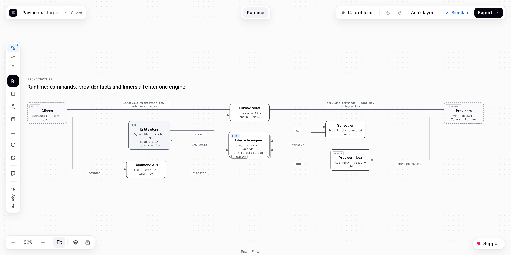
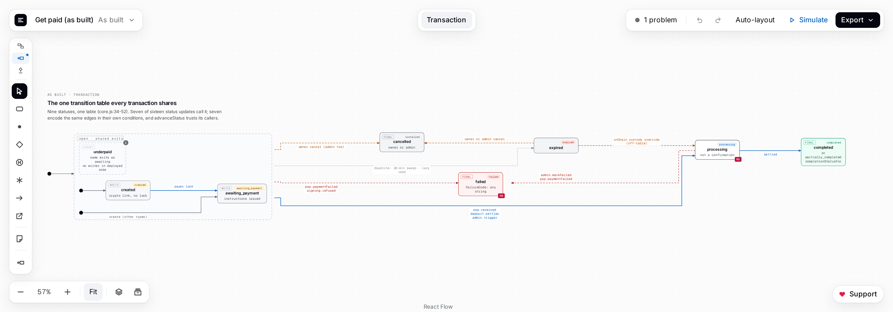

# Statewright

Statewright is a builder for **layered specifications of systems**: architecture views, state machines and procedural
flows, nested to any depth, stored as one signed JSON document (`*.sttw`). It is made to be worked on with
**AI coding agents** — Claude Code, Codex, Kimi, Cursor and others — beside a visual Editor where the person sees every
change an agent makes, and can undo it.



- **The Editor:** https://statewright.cpss.com.br — nothing to install; documents stay in your browser.
- **The plugin for Claude Code and Codex:** `/plugin install statewright --marketplace danilocoppi/statewright`.
- **The library and the command line:** `npm install statewright`, or `npx statewright --help` without installing.
- **The guide:** [docs/guide/README.md](docs/guide/README.md), also the npm package's README and
  https://statewright.cpss.com.br/readme.
- **The source:** https://github.com/danilocoppi/statewright, where problems and ideas go to its
  [issues](https://github.com/danilocoppi/statewright/issues).

**AI agents: read [AGENTS.md](AGENTS.md).**

## What it is for

A Statewright document is the **source of truth** about how a system behaves: people and AI agents read it to
implement or review the system, and engines analyse it for problems and conformity. The same diagram language serves
two uses:

1. **Design** — how a system should behave (`stage: "target"`).
2. **Audit of reality** — how code behaves today (`stage: "as-built"`), or what a third-party provider publishes
   (`stage: "reference"`), with its defects, legacy values, unknown edges and findings.

**Levels of detail.** Level 0 is generic: the services, stores, actors and providers of a system. Any box can be
entered to see the next level — the state machine behind a service, the sub-states of a state, the steps of a handler —
to any depth. Detail is always optional: a document can stop at level 0, and any field can be left unspecified.

**Privacy.** Statewright runs in the browser. Documents never leave your machine unless you export them, and the
library and command line work on local files.



## Start

**In the Editor.** Open https://statewright.cpss.com.br, create a project or open one of the examples, and draw:
double-click or Enter opens a box's level, Esc goes back up, `/` inserts anything by name and ⌘K (Ctrl+K) lists every
command with its keys. **Simulate** runs a machine or a flow step by step, and **Export** writes figures,
documentation and the contract.

**With an AI agent.** Install the plugin, or register the MCP server, then start a new session:

| Client            | How                                                                                                                         |
| ----------------- | --------------------------------------------------------------------------------------------------------------------------- |
| Claude Code       | `/plugin install statewright --marketplace danilocoppi/statewright`, or `claude mcp add statewright -- npx statewright mcp` |
| Codex             | `codex plugin marketplace add danilocoppi/statewright`, then `codex plugin add statewright@statewright`                     |
| Kimi CLI          | `kimi mcp add --transport stdio statewright -- npx statewright mcp`                                                         |
| Other MCP clients | The command `npx statewright mcp` in their MCP configuration                                                                |

Open a project in the Editor, choose **Connect an AI…** (the project menu, or ⌘K) and give your agent the code it
shows. The guide's [AI agents: start here](docs/guide/README.md#ai-agents-start-here) has the details.

**From the command line.** Node.js 22.12 or newer:

```sh
npx statewright new orders.sttw --name "Orders"
npx statewright apply orders.sttw batch.json   # a batch of commands builds the levels
npx statewright validate orders.sttw           # its Problems
npx statewright render orders.sttw -o orders.svg
```

The guide's [Quick start](docs/guide/README.md#quick-start) has a `batch.json` that builds a first document, and
[Command line](docs/guide/README.md#command-line) lists every command.

## Concepts in brief

A level is one of three kinds, or a mix of them ([Mixed levels](docs/guide/README.md#mixed-levels)):

| Kind      | Shows                                                                                | Boxes                                                                      |
| --------- | ------------------------------------------------------------------------------------ | -------------------------------------------------------------------------- |
| `system`  | Architecture: who talks to whom.                                                     | actors, services, stores, queues, external providers                       |
| `machine` | A state machine: the values a field takes and what moves it between them.            | states, choices, history, entries                                          |
| `flow`    | A procedure: steps, branches and loops (IF/ELSE, SWITCH, WHILE, FOR EACH, parallel). | actions, calls, waits, emits, webhooks, assignments, branches and subflows |

- **The catalog** declares once what diagrams mention — data types, events, actions, guards, endpoints, webhooks,
  timers, statuses and parties — and diagrams reference it by ID, so a rename never breaks anything.
- **Definitions** are reusable levels: every instance shows, and edits, the same body.
- **Reality and confidence:** every element can say whether it is built, proposed, a fix, a defect, legacy, documented
  or implied, cite the code or document it came from, and say how sure that is.
- **Problems** are what the rules find — errors, warnings and what is still incomplete — reported, never enforced: a
  design under construction is allowed to be incomplete.
- **The signature:** every write signs the document with SHA-256 hashes over a canonical form, so an edit made outside
  Statewright is detected.

The guide's [Concepts](docs/guide/README.md#concepts) explains each one.

## Working with an AI agent

Paired with the Editor, every operation of the Editor is a tool of the agent, and every change it makes appears in your
tab with Undo. Then work in one of three ways:

1. **Map the system you have.** The agent reads your code and draws what it does, level by level: every element cites
   the file and the lines it came from, and the defects it finds become findings you can see on the canvas —
   [Map your system, level by level](docs/guide/README.md#map-your-system-level-by-level).
2. **Design together.** The agent interviews you and builds the design top-down, level 0 first, then one level per box
   that needs detail — [Design a system with the person, level by level](docs/guide/README.md#design-a-system-with-the-person-level-by-level).
   [examples/bookings.sttw](examples/bookings.sttw) is that playbook's design.
3. **Build from the design.** Keep the `.sttw` in your repository as the source of truth: the agent
   implements what it says, and when the code must differ it changes the design with you first.
   `statewright contract` writes the design's machines, flows and scenarios as JSON for code
   ([The contract](docs/guide/README.md#the-contract)), and `--check` in CI says when the design has changed and the
   code may not have followed. Your tests run the scenarios through the code, and
   `statewright conform` turns what differs into findings on the canvas —
   [Build from the design](docs/guide/README.md#build-from-the-design).

A bar at the bottom of the Editor is your conversation with the agent
([Working with the person in the Editor](docs/guide/README.md#working-with-the-person-in-the-editor)):

- **Messages** carry the level you look at and what you selected; the agent answers there, pointing at the elements it
  means.
- **Marks:** mark elements for the AI, or draw on the canvas with a pencil, rectangles, ellipses and labels in four
  colours (wrong, question, right, neutral); the agent reads what each mark encloses or touches.
- **Quick requests** over a selection: explain, review, fill what is missing, write scenarios, detail a box, propose
  clearer names.
- **Questions:** the agent asks with options as buttons, or asks you to mark elements, instead of guessing.
- **Proposals:** large or structural changes, and removals unless you allow them, arrive as proposals drawn on the
  canvas, to step through and accept or reject.
- **Comments and locks:** leave review comments on elements, and lock what the agent may only change through a
  proposal. **Stop** halts the agent at once.

## Simulating and scenarios

A machine or a flow can be run: started, sent events and calls, and given time, one step at a time, to see where it
goes. A step that needs a decision the document does not settle — which guard holds, which branch is taken — stops and
asks. A run can be saved as a **scenario**, replayed when the design changes, and presented step by step on the canvas
or as a page of its own — [Simulating and scenarios](docs/guide/README.md#simulating-and-scenarios).

## Building from the design

Commit the contract beside the design: it is the version of the design the code was last aligned with.

```sh
npx statewright contract design/bookings.sttw -o design/bookings.contract.json
npx statewright contract design/bookings.sttw --since design/bookings.contract.json   # what changed since
npx statewright contract design/bookings.sttw --check design/bookings.contract.json   # in CI
```

- **Conformance:** your tests run the vectors through the real code with a small driver per machine, and
  `statewright conform` compares what the code did with the design — [Conformance](docs/guide/README.md#conformance).
- **The runtime:** a system written in JavaScript can run the design itself with `statewright/runtime`, the
  Simulator's engine, so the Editor's simulation, the contract's vectors and production behave alike —
  [The runtime](docs/guide/README.md#the-runtime).
- **Documentation:** `statewright docs` writes the design as Markdown, a pack for AI agents or a self-contained HTML
  page, and `statewright render` draws any level as SVG.

## Examples

All but Bookings open in the Editor from the Projects screen; [examples/rendered](examples/rendered) holds what
Statewright renders of them (figures, documentation, the contract, the audit and scenario pages).

| Example                                                | What it shows                                                                |
| ------------------------------------------------------ | ---------------------------------------------------------------------------- |
| [Payments](examples/payments.sttw)                     | Architecture, a payment lifecycle and a provider's machine                   |
| [Get paid (as built)](examples/get-paid-as-built.sttw) | One transition table audited from code, with its defects and findings        |
| [Order lifecycle](examples/order-lifecycle.sttw)       | Roles, a lifecycle, lanes and a mixed level                                  |
| [Payout batch](examples/payout-batch.sttw)             | A machine whose action a flow implements, with a recorded scenario           |
| [Bookings](examples/bookings.sttw)                     | The design built by the playbook _Design a system with the person_           |
| [Airport operations](examples/airport-operations.sttw) | The largest: 42 levels and 1,745 boxes, with every kind of level and element |

## The repository

| Path                                         | What it holds                                                                                                                    |
| -------------------------------------------- | -------------------------------------------------------------------------------------------------------------------------------- |
| [packages/core](packages/core)               | `statewright` on npm: the format, commands, rules, layout, rendering, simulation, the agent contract, the MCP server and the CLI |
| [apps/editor](apps/editor)                   | The Editor (React), published at https://statewright.cpss.com.br                                                                 |
| [plugins/statewright](plugins/statewright)   | The plugin for Claude Code and Codex                                                                                             |
| [docs/guide/README.md](docs/guide/README.md) | The guide, built into `packages/core/README.md`                                                                                  |
| [examples](examples)                         | Example documents, and what Statewright renders of them (`examples/rendered/`)                                                   |

## Developing

Node.js 22.12 or newer.

```sh
npm ci
npm test            # Core, then the Editor
npm run e2e         # the Editor end to end, on its production build (Playwright)
npm run editor:dev  # the Editor on http://localhost:5173
```

[AGENTS.md](AGENTS.md) lists every command, the conventions and the files that are generated.

## Support the project

Statewright is free and open source. If it helps you, a donation keeps it going — send only on these networks:

| Network                   | Address                                        |
| ------------------------- | ---------------------------------------------- |
| Solana                    | `DCA31TRz39qmKPseSRMjANN7cGYoWGUbtkC582oMRyWy` |
| ETH · BSC · Polygon (EVM) | `0x54636195948915f091466f027025973328813a3a`   |

## Licence

MIT — see [LICENSE](LICENSE).
