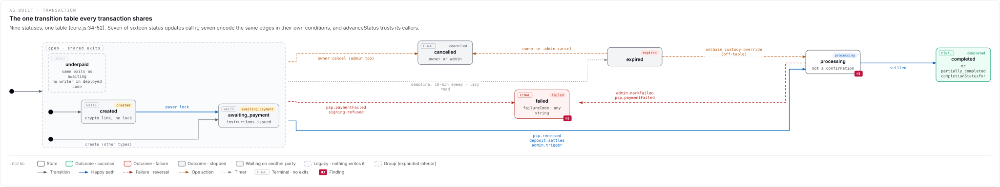
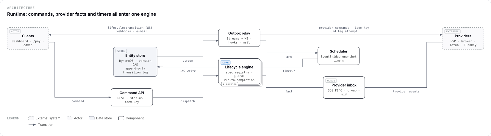

<!-- The npm README (packages/core/README.md) is built from docs/guide/README.md by npm run readme:build. -->

# Statewright

Statewright is a builder for **layered specifications of systems**: architecture views, state machines and
procedural flows, nested to any depth, stored as one signed JSON document. It is developed and designed to be worked
on together with **AI coding agents** such as Claude Code, Codex, Kimi and others: every operation of the Editor is also
a tool of `statewright mcp`, so an agent can model, simulate and audit a design on files, or pair with the Editor you
have open, where you see each of its changes and can undo it.

This guide is for people and for AI agents; agents [start here](#ai-agents-start-here). It covers what Statewright is
for, how documents work, how to read its diagrams and use the editor, simulating, the library and command line,
working with AI agents, the rules AI agents follow and step-by-step playbooks. The format reference closes it.

- [AI agents: start here](#ai-agents-start-here)
- [What Statewright is for](#what-statewright-is-for)
- [Concepts](#concepts)
- [Reading a diagram](#reading-a-diagram)
- [Using the editor](#using-the-editor)
- [Simulating and scenarios](#simulating-and-scenarios)
- [Library and CLI](#library-and-cli)
- [Working with AI agents](#working-with-ai-agents)
- [Building from the design](#building-from-the-design)
- [Rules for AI agents](#rules-for-ai-agents)
- [Playbooks](#playbooks)
- [Format reference](#format-reference)

The source is at https://github.com/danilocoppi/statewright (MIT); report a problem or ask for a feature in its issues,
https://github.com/danilocoppi/statewright/issues.

## AI agents: start here

When a person asks you to work with them in Statewright, take these steps in order. The rest of this guide is the
reference: read its sections as you need them, with `guide_read` (or `npx statewright guide <section>`), rather than
all at once.

**1. Set up the MCP server**, unless your tools already list `editor_pair`. `statewright mcp` runs with Node.js 22.12
or newer. Register it with your client, then start a new session (or reload the client's MCP servers) so its tools
appear. If you cannot run the command yourself, give the person the line for their client.

| Client            | How                                                                                                               |
| ----------------- | ----------------------------------------------------------------------------------------------------------------- |
| Claude Code       | `claude mcp add statewright -- npx statewright mcp`                                                               |
| Codex             | `codex mcp add statewright -- npx statewright mcp`                                                                |
| Kimi CLI          | `kimi mcp add --transport stdio statewright -- npx statewright mcp`                                               |
| Gemini CLI        | `gemini mcp add statewright npx statewright mcp`                                                                  |
| Cursor            | `{ "mcpServers": { "statewright": { "command": "npx", "args": ["statewright", "mcp"] } } }` in `.cursor/mcp.json` |
| Other MCP clients | The same command, `npx statewright mcp`, in their MCP configuration.                                              |

The first start downloads the package, and some clients wait only seconds for a server (Codex, 10): run
`npx statewright --version` once before you register it. Without an MCP client, the command line does the same work on
files (`npx statewright --help`).

**2. Pair with the person's Editor.** Ask them to open the Editor at https://statewright.cpss.com.br and choose
**Connect an AI…** on the Projects screen, before any project is open (it is also in a project's menu, and ⌘K). Chrome
may ask to let the page reach the local network: they allow it. They read you a
code such as `K7Q-2MX`: call `editor_pair { "code": "K7Q-2MX", "agent": "<your name>" }`. From then on every tool
without `file` works in their tab: each change you make glows on the canvas, carries your name in the history, and
they can undo it. Once paired, `projects_create` makes the project you design in, in their tab. To work on a document
file instead, pass its path as `file` to each tool; the person opens it later with **Open file…**.

**3. Ask which way, then read.** People work with an agent in three ways: ask which one the person wants, then read
its playbook and the [Rules for AI agents](#rules-for-ai-agents). `document_summary` says what the project already
holds.

- **Map the system they have:** read their code and draw what it does, level by level —
  [Map your system, level by level](#map-your-system-level-by-level).
- **Design together:** a new system, or a new part of one —
  [Design a system with the person, level by level](#design-a-system-with-the-person-level-by-level).
- **Build from a design they have:** read it (`document_summary`, `level_get`, or the AI pack, `export_aiPack`) and
  implement each machine and flow as it says; its contract (`export_contract`, or `statewright contract`) gives them
  with the names code holds, and `--since` what changed since the contract the code was built from; its scenarios,
  run through the code, prove it — [Build from the design](#build-from-the-design). The design is the source of truth:
  when the code must differ, change the design with the person first.

**4. Work level by level, with the person.** Whatever the way, go top-down. To design together, interview the person
first: what the system is for, who and what takes part (people, services, stores, outside providers) and which records
have a status that matters (an order, a booking, a payment). To map their system, read the code first (the playbook's
survey); to build from a design, read it level by level and implement it in the same order. Build level 0 alone and
ask the person to confirm it; then go one level deeper at a time, in the order they care about. Name things in the
person's words and language, and give each batch a `label` they will recognise in the history.

**5. Show, check and hand over.** After each batch, read `problems_list` and fix the errors; `incomplete` is fine while
a decision is open. Arrange new levels with `layout_arrange`, and point at what you changed or want to ask about with
`view_point` and a note rather than describing where it is. When behaviour matters, run it (`run_start`, `run_step`),
keep the run with `scenario_save` and show it with `scenario_present`. At the end, run `audit_report` and tell the
person what is still open.

## What Statewright is for

A Statewright document is the **source of truth** about how a system behaves: engines analyse it for conformity and
problems, and people and AI agents read it to implement or review the system.

The same diagram language serves two uses:

1. **Design** — how a system should behave (`stage: "target"`).
2. **Audit of reality** — how code behaves today (`stage: "as-built"`) or what a third-party provider publishes
   (`stage: "reference"`), including defects, legacy values, unknown edges and findings.

A primary use is an AI agent reading an existing codebase and modelling its flows, so that they become visual and easy
to understand.

**Levels of detail.** Level 0 is generic: the services, stores, actors and providers of a system. Any box can be
entered to see the next level — the state machine behind a service, the sub-states of a state, the steps of a handler —
to any depth. Detail is always optional: a document can stop at level 0, and any field can be left unspecified.

**Privacy.** Statewright runs in the browser. Documents never leave your machine unless you export them, and the
library and CLI work on local files.

## Concepts

### Documents

A document is one JSON file, by convention named `*.sttw`. Files saved before 0.1.5 end in `.statewright.json`; they
open as they are. It holds the project, a **catalog** of shared items, reusable **definitions**, the **canvases**
(diagrams), **annotations** and **layout**. Everything with an ID lives in a map keyed by that ID: `nod_running`,
`evt_payinConfirmed`, `cnv_lifecycle`. The prefix says what the element is (`cnv` canvas, `nod` node, `edg` edge, `rgn`
region, `def` definition, `typ` type, `evt` event, `act` action, `grd` guard, `ept` endpoint, `whk` webhook, `tmr`
timer, `sts` status, `pty` party, `fnd` finding, `nte` note, `lne` lane).
IDs are unique in the document and **never change**, even when an element is renamed.

Documents are strict: unknown keys are rejected (this catches typos), except keys starting with `x-`, which are kept
as extensions. The same document always serializes to the same bytes.

### Canvases and levels

There are three kinds of canvas:

| Kind      | Shows                                                                                | Nodes                                                                                                                                    |
| --------- | ------------------------------------------------------------------------------------ | ---------------------------------------------------------------------------------------------------------------------------------------- |
| `system`  | Architecture: who talks to whom.                                                     | `actor`, `service`, `store`, `queue`, `external`                                                                                         |
| `machine` | A state machine: the values a field takes and what moves it between them.            | `initial`, `entry`, `state`, `choice`, `history`, `any`                                                                                  |
| `flow`    | A procedure: steps, branches and loops (IF/ELSE, SWITCH, WHILE, FOR EACH, parallel). | `start`, `end`, `action`, `if`, `switch`, `while`, `forEach`, `parallel`, `join`, `emit`, `wait`, `call`, `webhook`, `assign`, `subflow` |

Every kind also has `ref` nodes: shortcuts to another canvas, node, definition or catalog item. Edges touching a `ref`
node are links (`kind: "link"`) and do not execute.

A node becomes **enterable** through `inner`: `{ "canvas": "cnv_x" }` is its own interior, `{ "definition": "def_x" }`
makes it an instance of a reusable definition. Which interiors are allowed:

| Element                                                       | Interior kinds        |
| ------------------------------------------------------------- | --------------------- |
| System nodes `actor`, `service`, `store`, `queue`, `external` | system, machine, flow |
| Machine `state`                                               | machine (sub-states)  |
| Flow `while`, `forEach`, `subflow`                            | flow (the body)       |
| Catalog `actions`, `endpoints`, `webhooks`                    | flow (the handler)    |

A canvas is the interior of exactly one owner; the document's `root` is level 0. Edges only connect nodes of the same
canvas — to point elsewhere, use a `ref` node.

**Machines** in more detail:

- A `state`'s `outcome` (`success`, `failure`, `stopped`) colours it; `terminal: true` says it has no exits. They are
  independent: a failed state can still be retried.
- `initial` is where a region starts (one per region, one outgoing transition without trigger). `entry` nodes are
  named creation paths (`POST /orders`). `choice` branches by guards with exactly one `else`. `any` holds transitions
  that apply from every non-terminal state of its region ("from any status"), except those in `except`.
- `regions` split a machine into parallel parts; every node then declares its `region`.
- A transition fires on any of its triggers: `on` (events), `onMatch` (event-name globs such as `leg.*`), `after` (a
  timer), `always` (as soon as its guard holds), `done` (the interior or a region completed), `via` (an endpoint or
  webhook call). Its `guard` is a condition; its `actions` are effects (call an action, emit an event, assign context).
- `subject` names the field the machine governs (`order.status`): state names are its values.

### Definitions

A definition (`def_*`) is a reusable canvas. Elements whose `inner` is `{ "definition": "def_x" }` are its instances:
entering one shows — and edits — the definition. `definition.detach` turns an instance into an independent copy.
Definitions may contain instances of other definitions, but never of themselves.

### The catalog

Things that diagrams mention are declared once in the catalog and referenced by ID: `types` (data contracts), `events`
(`payin.confirmed`), `actions`, `guards` (named predicates), `endpoints` (`POST /payments`), `webhooks`, `timers`,
`statuses` (public status values) and `parties` (who acts: humans, operators, systems, external providers). Renaming a
catalog item never breaks its references.

### Reality and confidence

Every element can say how it relates to reality:

- `provenance`: `built` (exists in code), `proposed` (not in code yet), `fix` (a proposed correction), `defect` (exists
  but is wrong), `legacy` (nothing writes it any more), `documented` (taken from third-party documentation), `implied`
  (exists but is not documented).
- `evidence`: where it was observed — `{ "kind": "code", "path": "src/orders.js", "lines": "34-52" }` or
  `{ "kind": "doc", "url": "…" }`.
- `confidence`: `high` (default), `medium` or `low`. Low-confidence elements are dimmed and reported for verification.
- A canvas's `stage` is `target`, `as-built` or `reference`.

### Completeness

Detail is optional, and the format separates **unknown** from **none**. For behavioural fields (event `payload`,
endpoint `request`, transition triggers and guards, effects, …) an **absent key means unspecified**, while a present
key means explicitly empty: `[]` for lists, `""` for text, `{}` for maps and `null` where the format reference lists
`null` (type references such as `payload: null`, "this event carries no data"). Single references to other elements
(`source`, `party`, `after`, …) have no empty form: leave them out.

A machine's `transitions` says how much is known about its edges: `complete` (a missing edge means "not allowed"),
`partial` (the default: edges may be missing) or `unknown` (do not judge the edges at all).

### Annotations

Annotations describe the specification without being part of it: **findings** (`fnd_*`, a coded problem such as `AS2`
with a severity and targets, usually written by an analysis engine), **notes** (callouts on a canvas), **focus** (nodes
and edges to look at), **lanes** (captions above a row of nodes) and **scenarios** (`scn_*`, recorded runs of a machine,
see [Simulating and scenarios](#simulating-and-scenarios)). They are signed separately from the specification, so
engines can write them without "changing the spec".

### Signature

Every write through Statewright signs the document with three SHA-256 hashes — `content` (the specification),
`annotations` and `layout` — over a canonical form, so reformatting never changes them. A file edited by hand still
opens, but verification reports the changed part, and the CLI refuses to re-sign changed content unless told to
(`--accept-changes`). The signature detects edits made outside Statewright; it is not tamper protection.

### Problems

`check(doc)` (and `statewright validate`) runs structural rules and returns **Problems**:
`{ code, severity, target, canvas?, message, data? }`. Severities are `error`, `warning` and `incomplete`. Rules marked
"by level" follow the machine's `transitions`: an `error` when `complete`, `incomplete` when `partial`, skipped when
`unknown`. Problems are reported, never enforced: a document under construction is allowed to be incomplete.

<!-- generated:rules -->

| Code | Severity | Reported when |
| --- | --- | --- |
| `ref.dangling` | error | A reference points to a missing ID. |
| `ref.kind` | error | A reference points to the wrong kind of element: an end, region or lane node on another canvas, an interior of a kind the element cannot hold, a definition body of another kind, … |
| `id.duplicate` | error | The same ID is used twice in the document. |
| `canvas.orphan` | warning | A non-root canvas is not referenced by any inner or definition. |
| `canvas.multiOwner` | error | A canvas is the interior of more than one owner (reuse goes through definitions). |
| `canvas.dense` | warning | A canvas has more than 12 nodes (suggests moving detail into a level). |
| `definition.cycle` | error | Definitions contain each other (directly or through other levels). |
| `canvas.cycle` | error | Own interiors contain each other, so the levels never end. |
| `machine.region` | error | On a machine with regions every node declares one; without regions no node does. |
| `machine.noStart` | by level | A region has neither an initial node nor an entry. |
| `machine.multipleInitial` | error | A region has more than one initial node. |
| `machine.initialEdge` | error | An initial node does not have exactly one outgoing transition, or that transition has a trigger. |
| `machine.unreachable` | by level | A state cannot be reached from the initial nodes and entries. |
| `machine.stuck` | by level | A non-terminal state has no way out (own, enclosing-state or any transitions). |
| `machine.sameName` | warning | Two states of one level and region share a name: code that holds the state by its name cannot tell them apart. |
| `machine.terminalWithExits` | error | A terminal state has outgoing transitions. |
| `machine.ambiguous` | error | Two transitions from one source share a trigger with no guard (or the same guard) to tell them apart. |
| `machine.crossRegion` | error | A transition connects nodes in different regions. |
| `choice.else` | error | A choice does not have exactly one else branch, or one of its branches has a trigger. |
| `transition.noTrigger` | incomplete | A transition out of a state has no trigger (on, onMatch, after, always, done or via). |
| `history.outsideCompound` | warning | A history node is in a machine that is not the interior of a state. |
| `edge.link` | error | On machine and flow canvases, an edge touching a ref node is not a link, or a link touches none. |
| `edge.target` | error | An initial, entry or any node is the target of an edge. |
| `flow.start` | error | A flow does not have exactly one start node. |
| `flow.deadEnd` | error | A flow node other than end has no outgoing edge. |
| `flow.unreachable` | warning | A flow node cannot be reached from the start node. |
| `flow.branches` | incomplete | An if lacks its true or false edge; a while, forEach or subflow has no body. |
| `flow.switchDefault` | warning | A switch has no default edge. |
| `event.name` | error | An event name is invalid or used by another event. |
| `catalog.unused` | warning | A catalog item is never referenced. |
| `spec.unspecified` | incomplete | Key behavioural fields are unspecified: event payload, endpoint request/responses, webhook payload, timer duration/at, guard without expr and description. |
| `confidence.low` | incomplete | An element has confidence: low and needs verification. |
| `expr.operator` | warning | A JSON Logic expression uses an operator outside the standard set. |
| `layout.overlap` | warning | Nodes or edge labels overlap in the stored layout (run statewright layout --all to recompute it). |
| `scenario.diverged` | warning | Running a saved scenario again no longer gives what it recorded. |

<!-- /generated:rules -->

## Reading a diagram

Every canvas renders as one figure (`statewright render`, and later the Editor's image export): a header, the diagram
and a legend of the styles it actually uses.



**Header.** The kicker in small capitals (`code`, then `kicker`, or the stage and the subject), the title (`title`, or
the canvas `name`) and the caption.

**Boxes.** The look comes from the meaning; there is no free colour. The first match wins: provenance (defect, proposed
or fix, legacy, implied), focus, the kind of system element (actor, external, store), the outcome, the category, then
plain.

- Chips at the top left, in order: provenance (`NEW`, `FIX`, `LEGACY`, `DEFECT`, `IMPLIED`), the kind (`ACTOR`,
  `EXTERNAL`, `STORE`, `QUEUE`, `WHILE`, …), `FINAL` for terminal states, the category (`WAITS`, `HOLD`, `LIVE`), then
  your tags.
- Pills at the top right: the public statuses the state maps to, coloured by each status's tone.
- A badge at the bottom right: the codes of the findings on the element (`H1 · H3`). Its tooltip lists their titles;
  in the Editor, the pointer resting on it shows each finding whole, with its source and evidence.
- Under the name, in monospace: the `summary`. Low-confidence elements are drawn at 60 % opacity.
- A second outline behind a box means it has an interior: enter it to see the next level. With `display: "card"` the
  box also shows a summary of the interior (`none → received → settled`); with `display: "frame"` the interior is drawn
  inline inside a dashed frame with a tab, and the owner's edges leave from the frame's border — that is how shared exits
  are drawn.
- Pseudo-nodes: a black dot is where a machine or flow starts (`initial`, `start`, or an `entry` nobody performs — its
  name labels its edge); a ringed dot is a flow's `end`; a diamond is a `choice`, `if` or `switch`; `H` is a `history`
  node; a black bar is a `parallel` split or a `join`; a dashed pill is an `any` node ("from any state").

**Edges.** The first match wins: provenance, failure, an operator performing it, a timer-only trigger, the happy path,
then the default; links to `ref` nodes are thin and dashed. Unless `label` is set, the label lists the triggers joined by
`|` — event names, `onMatch` patterns, timer names, `done` or `<region> ✓`, `METHOD /path` for `via` — then the guard in
brackets: `payin.confirmed | timer.expiry [scaled]`. Long labels put each trigger on its own line. The codes of the
findings on an edge are a badge under its label, or under the middle of its route when it has none.

**Around the boxes.** Lanes are small-capital captions above a row of boxes; notes are callouts (a crimson dotted loop
above a box for a defect); the regions of a machine are separate dashed areas, each with its name.

<!-- generated:legend -->

| Node style | Look | Legend says |
| --- | --- | --- |
| `state.plain` | fill #FFFFFF, stroke #3B3F4A | State |
| `state.focus` | fill #EEF4FB, stroke #0A66C2 | Look here |
| `outcome.success` | fill #ECFDF5, stroke #059669 | Outcome · success |
| `outcome.failure` | fill #FEF3F2, stroke #B42318 | Outcome · failure |
| `outcome.stopped` | fill #F3F4F6, stroke #6B7280 | Outcome · stopped |
| `state.waiting` | fill #F6F7FA, stroke #878E91, chip WAITS | Waiting on another party |
| `state.hold` | fill #FFFBEB, stroke #B45309, chip HOLD | Hold · manual review |
| `state.processing` | fill #FFFFFF, stroke #3B3F4A, chip LIVE | Processing |
| `prov.proposed` | fill #FFFFFF, stroke #0A66C2, dashed 4,3, chip NEW | Proposed (not in code yet) |
| `prov.fix` | fill #FFFFFF, stroke #0A66C2, dashed 4,3, chip FIX | Proposed fix |
| `prov.legacy` | fill #FAFBFD, stroke #B9BDC9, dashed 6,4, chip LEGACY | Legacy · nothing writes it |
| `prov.defect` | fill #FFF1F2, stroke #BE123C, dashed 3,2, chip DEFECT | Defect |
| `prov.implied` | fill #FFFFFF, stroke #B9BDC9, dashed 2,3, chip IMPLIED | Implied · not documented |
| `node.external` | fill #FAFAFC, stroke #878E91, dashed 4,3, chip EXTERNAL | External system |
| `node.actor` | fill #FAFAFC, stroke #878E91, dashed 4,3, chip ACTOR | Actor |
| `node.store` | fill #F3F5F9, stroke #5B6170, chip STORE | Data store |
| `node.plain` | fill #FFFFFF, stroke #3B3F4A | Component |
| `step.plain` | fill #FFFFFF, stroke #3B3F4A | Step |
| `node.ref` | fill #FFFFFF, stroke #878E91, dashed 3,2 | Shortcut to another element |
| `frame` | fill #FAFBFD, stroke #B9BDC9, dashed 6,4 | Group (expanded interior) |

| Edge style | Look | Legend says |
| --- | --- | --- |
| `edge.default` | stroke #5B6170, width 1.2, solid | Transition |
| `edge.happy` | stroke #0A66C2, width 1.6, solid | Happy path |
| `edge.failure` | stroke #B42318, width 1.2, dashed 5,4 | Failure · reversal |
| `edge.ops` | stroke #B45309, width 1.2, dashed 6,3 | Ops action |
| `edge.timer` | stroke #878E91, width 1.2, dashed 2,3 | Timer |
| `edge.defect` | stroke #BE123C, width 1.4, dashed 2,2 | Defect |
| `edge.proposed` | stroke #0A66C2, width 1.2, dashed 4,3 | Proposed |
| `edge.implied` | stroke #E11D48, width 1.2, dashed 4,3 | Implied · not documented |
| `edge.link` | stroke #878E91, width 1, dashed 3,2 | Link (not executable) |

<!-- /generated:legend -->

The architecture of the payments example, rendered from its JSON:



## Using the editor

The editor is the platform's web app: it draws each level of a document as its figure and edits it, and everything
stays in the browser. A double-click or Enter on a box with a second outline opens its level; Esc goes back up. A
selected box shows in the inspector: what a reviewer needs first, the technical details on request.

The tool dock on the left holds the tools of the level shown. A level is a system, a state machine or a flow, and holds
only its kind's elements, so the tools cannot switch; under them, the level's kind says which it is, and its menu leads
to a level of another kind. Select a box that can hold one (a system's box, a state, a loop or a subflow) and choose
**Create inside** → Flow, State machine or System, as the inspector's **Interior** adds it: the new level opens, with
its tools in the dock, and one Undo takes it back. A box that already has a level offers to **Open** it instead.

Search and commands (⌘K, or Ctrl+K on Windows and Linux) lists every command with its keys: Shift+F fits the level in
the view (Shift+1 too), Shift+A lays it out again (Shift+L too). These keys act where the focus is:

| Key            | What it does                                                                                                                   |
| -------------- | ------------------------------------------------------------------------------------------------------------------------------ |
| Tab, Shift+Tab | Move between the boxes of the level as a figure is read: left to right, then top to bottom.                                    |
| Arrows         | With nothing selected, move to the box connected that way; with a selection, move it (Shift: ten times as far).                |
| Space          | Select the box with the focus; Shift+Space adds it to the selection or takes it out.                                           |
| Enter          | Open the box's level; on a selected arrow, choose what triggers it.                                                            |
| Esc            | Clear the selection; with nothing selected, go up a level.                                                                     |
| F2             | Rename the box.                                                                                                                |
| F6, Shift+F6   | Move to the next or previous area: the islands at the top, the Problems, the inspector, the tools, the level and its zoom.     |
| Shift+F10      | Open the menu of the selection.                                                                                                |
| 1 to 9         | While simulating, answer the question the run asks.                                                                            |
| →              | While a scenario is followed, take its next step.                                                                              |
| ← →, Space     | On the stage, the step before or after; Page Up and Page Down too, Home and End the first and the last, Esc back to the panel. |

**Export → Documentation (HTML)** saves the whole project as one page to read, share or print: a cover with its
numbers, the map of its levels, each level with its diagram, its tables, its scenarios and its findings, the catalog
and the findings, with the contents on the left marking the part being read. It opens offline and asks for nothing;
Documentation (Markdown) says the same in Markdown. The CLI writes it with `statewright docs <file> --format html`, the
library with `toDocumentPage(doc, { fonts? })` from `statewright/render`; `examples/rendered/<name>/documentation.html`
has one per example.

## Simulating and scenarios

A machine or a flow can be run: started, sent events and calls, and given time, one step at a time, to see where it
goes. The library does it with `statewright/simulate`, which is pure: the same document, session and input always give
the same result, and nothing reads the real clock.

- **A run** starts from a machine that runs on its own (one that is not the inside of a state) with every level inside
  it. Each region starts at its initial node, or at an entry. A step is an event, a call (an endpoint or webhook a
  transition is triggered `via`) or time passing, and it runs to completion: the innermost transition wins, every
  region takes its own, exits run before the transition's actions and entries after them, and the events the machine
  raises are handled before the step ends.
- **A flow** runs with tokens. One starts at `start`, with the run's input as `vars.input`, and moves until it ends,
  waits at a `wait` or needs an answer: `action`, `call` and `webhook` nodes are logged, `assign` writes `vars` or the
  run's own context, `if` and `switch` take their edge, `while`, `forEach` and `subflow` run their body (a token there
  has its owner's ID before its own: `nod_each/nod_pix`), `parallel` forks a token per edge and `join` waits for one on
  each. A `wait` lets its token go on when its event comes or its timer falls due. The run ends with its last token,
  `success` or `failure` (`failure` wins). The repository's `examples/payout-batch.sttw` is a flow with a
  recorded scenario.
- **Questions.** A guard with a JSON Logic `expr` is evaluated against `{ event, context, vars }`. A guard the document
  only names or describes in words is a question for the person running it: which of the transitions holds, or which
  branch of a choice is taken. A flow asks which `branch` an `if` or a `while` takes, which `case` of a `switch`, the
  `outcome` of a node with an error edge (did it work?), and the `count` of a `forEach` whose items it cannot tell. A
  step that needs an answer stops, returns the question, and is taken again with the answer; the session is never left
  halfway.
- **Time** moves only when a step waits: a duration (`PT2H`) or until the next timer. Timers are armed when their state
  is entered and cancelled when it is left; an `at` timer reads its deadline from the machine's context; the business
  calendar counts Monday to Friday; an `sla` and a timer's reminders only warn.
- **In the editor**, Simulate (beside the Problems) runs the level shown — on a system level, what runs inside it —
  from the starting values its machines declare. The panel says where the run is now, what can happen (each event,
  call and timer with where it leads), the questions the design leaves open (keys 1 to 9 answer them) and the steps
  taken, each with what happened inside it; ⌘Z goes back one step. The level marks where the run is and the edges
  that can fire now, whose labels take their step. Save as scenario… keeps the run in the document; Run follows a
  scenario one step at a time (→), and where it now goes elsewhere, Accept the new path records what the design does.
- **Presenting.** Present (beside Run, or in the panel while a scenario runs) shows the scenario on a stage over the
  whole screen, one step at a time: the level where each step happens, the edges it takes pulsing in order while the
  run moves on, and a card with the step's input, the clock and its caption, or what it did when it has none. → and
  Space go on, ← goes back, Esc returns to the panel at the same step. Export as page… (in a scenario's menu, or
  Scenario page… in Export) saves it as one HTML file anyone can open in a browser, offline: its steps beside the
  diagram, ← → to step through, and Present for the stage. The library makes the same page with
  `toScenarioPage(doc, scenarioId)` from `statewright/render`; `examples/rendered/payments/` has one per scenario.
- **Scenarios** are recorded runs kept in the document (`annotations.scenarios`, format 1.1): where the run starts,
  each step's input and answers, and the states (or a flow's tokens) each step reached. `check` runs every scenario again and reports
  `scenario.diverged` at the first step that now goes elsewhere. Recording a scenario never changes the content's
  signature.

<!-- checked:simulate -->

```js
import { moves, start, step } from "statewright/simulate";

// `doc`: the order of the quick start below, after its batch.
const begun = start(doc, { canvas: "cnv_lifecycle", at: "2026-01-05T09:00:00Z" });
console.log(begun.session.active); // ["nod_pending"]: its region starts at its only entry
console.log(moves(doc, begun.session).map(move => move.label)); // ["payment.confirmed", "payment window"]
const paid = step(doc, begun.session, { do: { event: "evt_paymentConfirmed" } });
console.log(paid.session.active); // ["nod_paid"]
const late = step(doc, begun.session, { do: { wait: "P2D" } });
console.log(late.session.active, late.session.ended); // ["nod_expired"] "done"
```

## Library and CLI

### Install

```sh
npm install statewright        # the library
npx statewright --help         # the command line, without installing
```

Node.js 22.12 or newer. The library also runs in browsers (no Node-only APIs outside the CLI).

### Quick start

Create a document, apply a batch of commands, then check it:

```sh
npx statewright new orders.sttw --name "Orders"
npx statewright apply orders.sttw batch.json
npx statewright validate orders.sttw
npx statewright inspect orders.sttw
```

`batch.json` builds level 0 (a customer calling an order API) and the order lifecycle inside the API:

<!-- checked:batch -->

```json
[
  {
    "type": "catalog.add",
    "args": { "collection": "parties", "id": "pty_customer", "item": { "kind": "human", "name": "Customer" } }
  },
  {
    "type": "catalog.add",
    "args": {
      "collection": "endpoints",
      "id": "ept_createOrder",
      "item": {
        "name": "Create order",
        "method": "POST",
        "path": "/orders",
        "request": null,
        "responses": { "201": null }
      }
    }
  },
  {
    "type": "catalog.add",
    "args": {
      "collection": "events",
      "id": "evt_paymentConfirmed",
      "item": { "name": "payment.confirmed", "payload": null }
    }
  },
  {
    "type": "catalog.add",
    "args": { "collection": "events", "id": "evt_orderShipped", "item": { "name": "order.shipped", "payload": null } }
  },
  {
    "type": "catalog.add",
    "args": {
      "collection": "timers",
      "id": "tmr_paymentWindow",
      "item": { "name": "payment window", "duration": "P1D" }
    }
  },
  {
    "type": "node.add",
    "args": {
      "canvas": "cnv_orders",
      "id": "nod_customer",
      "node": { "kind": "actor", "name": "Customer", "party": "pty_customer" }
    }
  },
  {
    "type": "node.add",
    "args": { "canvas": "cnv_orders", "id": "nod_orderApi", "node": { "kind": "service", "name": "Order API" } }
  },
  {
    "type": "edge.add",
    "args": {
      "canvas": "cnv_orders",
      "edge": { "from": "nod_customer", "to": "nod_orderApi", "kind": "command", "endpoint": "ept_createOrder" }
    }
  },
  {
    "type": "canvas.create",
    "args": {
      "kind": "machine",
      "name": "Order lifecycle",
      "id": "cnv_lifecycle",
      "owner": "nod_orderApi",
      "subject": "order.status",
      "stage": "target",
      "transitions": "complete"
    }
  },
  {
    "type": "node.add",
    "args": {
      "canvas": "cnv_lifecycle",
      "id": "nod_create",
      "node": { "kind": "entry", "name": "POST /orders", "via": "ept_createOrder", "by": "pty_customer" }
    }
  },
  {
    "type": "node.add",
    "args": {
      "canvas": "cnv_lifecycle",
      "id": "nod_pending",
      "node": { "kind": "state", "name": "pending", "category": "waiting" }
    }
  },
  {
    "type": "node.add",
    "args": { "canvas": "cnv_lifecycle", "id": "nod_paid", "node": { "kind": "state", "name": "paid" } }
  },
  {
    "type": "node.add",
    "args": {
      "canvas": "cnv_lifecycle",
      "id": "nod_shipped",
      "node": { "kind": "state", "name": "shipped", "outcome": "success", "terminal": true }
    }
  },
  {
    "type": "node.add",
    "args": {
      "canvas": "cnv_lifecycle",
      "id": "nod_expired",
      "node": { "kind": "state", "name": "expired", "outcome": "stopped", "terminal": true }
    }
  },
  { "type": "edge.add", "args": { "canvas": "cnv_lifecycle", "edge": { "from": "nod_create", "to": "nod_pending" } } },
  {
    "type": "edge.add",
    "args": {
      "canvas": "cnv_lifecycle",
      "edge": { "from": "nod_pending", "to": "nod_paid", "on": ["evt_paymentConfirmed"], "intent": "happy" }
    }
  },
  {
    "type": "edge.add",
    "args": {
      "canvas": "cnv_lifecycle",
      "edge": { "from": "nod_paid", "to": "nod_shipped", "on": ["evt_orderShipped"], "intent": "happy" }
    }
  },
  {
    "type": "edge.add",
    "args": {
      "canvas": "cnv_lifecycle",
      "edge": { "from": "nod_pending", "to": "nod_expired", "after": "tmr_paymentWindow", "intent": "failure" }
    }
  }
]
```

`apply` prints the IDs it created (edges get IDs from their ends: `edg_pendingPaid`) and a count of Problems; this
batch leaves none.

### Command line

`statewright <command> [options]`. Every command accepts `--json` (machine-readable output on stdout) and `--help`.
Exit codes: `0` success, `1` the document has errors (or, with `verify --strict`, a changed signature), `2` usage or
I/O error. Failures print one line on stderr; with `--json` the error is also printed as JSON on stdout.

| Command                                                                | Does                                                                                                                                                                                                                                                                                                                                                                                                       |
| ---------------------------------------------------------------------- | ---------------------------------------------------------------------------------------------------------------------------------------------------------------------------------------------------------------------------------------------------------------------------------------------------------------------------------------------------------------------------------------------------------- |
| `new <file> --name <project>`                                          | Creates an empty signed document whose root is a system canvas named after the project. `--force` overwrites, `--agent <name>` records who wrote it.                                                                                                                                                                                                                                                       |
| `validate <file>`                                                      | Parses, migrates (in memory) and checks the document; prints its Problems.                                                                                                                                                                                                                                                                                                                                 |
| `audit <file> [--format md\|json]`                                     | Audits the document: its Problems, every scenario run again and how much of each machine and flow level the scenarios reach (`--canvas <id>` for one level, `-o <file>` to write it). Exit 1 when it has errors.                                                                                                                                                                                           |
| `verify <file>`                                                        | Checks the signature per scope: `ok`, `changed` or `missing`. `--strict` exits 1 when something changed.                                                                                                                                                                                                                                                                                                   |
| `apply <file> <commands.json \| ->`                                    | Applies a batch atomically (from a file, or stdin with `-`), re-signs and writes. `--out <file>` writes elsewhere, `--dry-run` writes nothing, `--agent <name>` records who wrote it.                                                                                                                                                                                                                      |
| `inspect <file> [id]`                                                  | Prints the levels of the document, or one element with its location and usages.                                                                                                                                                                                                                                                                                                                            |
| `layout <file> [--canvas <id>] [--all]`                                | Places nodes that have no position (`--all` recomputes every position), re-signs and writes. Same `--out`, `--dry-run`, `--agent` as `apply`.                                                                                                                                                                                                                                                              |
| `render <file> [--canvas <id>] [-o <file>]`                            | Draws a canvas (default: the root) as SVG, to a file or to stdout. Missing positions are computed, not stored.                                                                                                                                                                                                                                                                                             |
| `docs <file> [--format md\|ai\|html] [-o <file>]`                      | Writes documentation: Markdown for people (`md`, the default), the AI pack (`ai`) or the documentation as a page (`html`, one self-contained HTML file with the system's fonts), to a file or to stdout.                                                                                                                                                                                                   |
| `contract <file> [-o <out>] [--since <contract>] [--check <contract>]` | Writes the design's contract for code: its machines with the names code holds, its flows, its scenarios as test vectors (see [The contract](#the-contract)). `--since` lists what changed since a contract; `--check` exits 1 when a committed contract is no longer the design's. Exit 1 also when two states of one level share a name.                                                                  |
| `conform <file> <results> [--write]`                                   | Compares the results a system's tests wrote after running the contract's vectors with the design (see [Conformance](#conformance)): a step whose states differ, or that threw, becomes a finding on the transition it breaks, which `--write` keeps in the design (source `conformance`); `--format md\|json`. Exit 1 when a step diverged or threw, or the results are for another version of the design. |
| `migrate <file>`                                                       | Migrates the document to the newest format and writes it. Same `--out`, `--dry-run`, `--agent` as `apply`.                                                                                                                                                                                                                                                                                                 |
| `schema`                                                               | Prints the JSON Schema of the format.                                                                                                                                                                                                                                                                                                                                                                      |
| `commands [type]`                                                      | Lists the document commands with their arguments, or prints one command's argument schema.                                                                                                                                                                                                                                                                                                                 |
| `mcp [--file <path>] [--port <n>] [--origin <url>]`                    | Serves the agent contract to an AI agent over MCP, on stdio: every operation is a tool (`batch_apply`, `run_step`, `audit_report`, …) working on the document its `file` names, in the Editor tab paired through the bridge on 127.0.0.1, or on `--file`. Set it up in Claude Code with `claude mcp add statewright -- npx statewright mcp`; see [Working with AI agents](#working-with-ai-agents).        |
| `guide [section]`                                                      | Prints this guide, or one of its sections by ID or title (`statewright guide start-here`).                                                                                                                                                                                                                                                                                                                 |

Commands that write (`apply`, `layout`, `migrate`, `conform --write`) refuse a document whose content was changed
outside Statewright; review the change, then pass `--accept-changes` to re-sign it. Any `<file>` can be `-` to read from
stdin; a command that then writes needs `--out <file>`.

### Library

<!-- checked:library -->

```js
import { applyBatch, applyPatches, check, createDocument, parse, sign, stringify, verify } from "statewright";

const doc = createDocument({ name: "Orders" }); // project prj_orders, root canvas cnv_orders
const {
  doc: next,
  created,
  inversePatches
} = applyBatch(doc, [
  { type: "node.add", args: { canvas: "cnv_orders", node: { kind: "service", name: "Order API" } } }
]);
console.log(created); // ["nod_orderApi"]
console.log(check(next)); // Problems
const text = stringify(await sign(next, { channel: "api", agent: "my-tool" }));

const result = parse(text); // never throws: { ok, doc, errors: [{ path, message }], migrations }
console.log(await verify(result.doc)); // { content: "ok", annotations: "ok", layout: "ok" }
const undone = applyPatches(next, inversePatches); // undo
```

| Area       | API                                                                                                                                                                                                                                                                                                                                                                                                                                                                                                                                                                                |
| ---------- | ---------------------------------------------------------------------------------------------------------------------------------------------------------------------------------------------------------------------------------------------------------------------------------------------------------------------------------------------------------------------------------------------------------------------------------------------------------------------------------------------------------------------------------------------------------------------------------- |
| Files      | `parse(text)`, `parseValue(raw)`, `stringify(doc)`, `createDocument({ name, kind? })`, `migrate(raw)`                                                                                                                                                                                                                                                                                                                                                                                                                                                                              |
| Signature  | `sign(doc, { channel, agent? })`, `verify(doc)`, `computeHashes(doc)`                                                                                                                                                                                                                                                                                                                                                                                                                                                                                                              |
| Changes    | `apply(doc, command)`, `applyBatch(doc, commands)`, `applyPatches(doc, patches)`, `listCommands()`                                                                                                                                                                                                                                                                                                                                                                                                                                                                                 |
| Analysis   | `check(doc)`, `listRules()`                                                                                                                                                                                                                                                                                                                                                                                                                                                                                                                                                        |
| Queries    | `buildIndex(doc)`, `resolve`, `usagesOf`, `ownersOf`, `hierarchy`, `pathTo`, `collectRefs`                                                                                                                                                                                                                                                                                                                                                                                                                                                                                         |
| Format     | `documentSchema` (zod), `toJSONSchema()`, `FORMAT_VERSION`; the JSON Schema is also `statewright/schema.json`                                                                                                                                                                                                                                                                                                                                                                                                                                                                      |
| Visuals    | `createStyle(doc)`, `nodeStyle`, `edgeStyle`, `edgeLabel`, `legendFor`, `cardSummary`; `figureOf(doc, canvasId, { paint? })`, `figureHeading(canvas)`, `edgeMarkers(keys, { idPrefix })` (the parts of a figure, without the layout engine); `autoLayout(doc, canvasId, { scope })` and `measureOverlaps` from `statewright/layout`; `toSVG(doc, canvasId)` and `toScenarioPage(doc, scenarioId, { fonts? })` (a scenario as a page that needs nothing else) and `toDocumentPage(doc, { fonts? })` (the whole project as a page to read, share or print) from `statewright/render` |
| Docs       | `toMarkdown(doc)`, `documentModel(doc)` (what the documentation says, shared by the Markdown and the page), `toAIPack(doc, { guideUrl? })`, `typeSchema(doc, typeId)` (a catalog type as JSON Schema)                                                                                                                                                                                                                                                                                                                                                                              |
| Simulation | `start`, `step`, `moves`, `fire` (one armed timer), `replay`, `reachedOf`, `executableOf`, `locate`, `instancesOf`, `storyOf`, `frameOf` from `statewright/simulate` (`start`, `step`, `moves` and `fire` take `{ guards }`, functions for named guards by ID); `logic.evaluate(expr, data)` (JSON Logic)                                                                                                                                                                                                                                                                          |
| Audit      | `coverageOf(doc)`, `auditOf(doc, { canvas? })`, `toAuditReport(doc, { canvas? })` from `statewright/audit`                                                                                                                                                                                                                                                                                                                                                                                                                                                                         |
| Contract   | `toContract(doc)` (the contract and the Problems that make it ambiguous), `stringifyContract(contract)`, `parseContract(text)`, `diffContracts(before, after)`, `toChangesMarkdown(diff)` from `statewright/contract`                                                                                                                                                                                                                                                                                                                                                              |
| Conform    | `conformOf(doc, results)` (the results of a system's tests compared with the design: findings and the transitions no passing vector proves), `toConformReport(report)`, `runVector(vector, driver)`, `runVectors(contract, driver, { only?, runner? })`, `writeResults(path, results)`, `parseResults(text)`, `checkResults(value)` from `statewright/conform`                                                                                                                                                                                                                     |
| Runtime    | `createRuntime(doc, { guards?, expect? })` → `{ content, machine(key) }`; a machine's `start`, `send`, `can`, `moves`; `RuntimeError` — from `statewright/runtime`                                                                                                                                                                                                                                                                                                                                                                                                                 |
| Agents     | `OPERATIONS` (the contract of operations agents call, AI interface spec §4), `validateCall(name, args)`, `inputSchemaOf(name)`, `checkResult(name, result)`, `errorsOf(name)` (the codes a call can answer), `toolNameOf(name)`, `AgentError`; `createFileHost({ files, agent?, file? })` runs the contract on document files (`memoryFiles(initial)` keeps them in memory) — from `statewright/agent`                                                                                                                                                                             |
| Guide      | `renderGuide(source)`, `formatReference()`, `commandsReference()`, `rulesReference()`, `legendReference()`, `operationsReference()`                                                                                                                                                                                                                                                                                                                                                                                                                                                |

Documents are plain JSON objects. Results of `applyBatch` are frozen and share unchanged parts with the input, so treat
every document as read-only and keep the newest result.

### Commands

Every change to a document is a command `{ "type": "node.add", "args": { … } }`, and a batch is an array of commands.

- **Atomic.** Either every command of a batch applies, or the document is unchanged and the error says why: a
  `CommandError` with `code` (`INVALID_ARGS`, `NOT_FOUND`, `WRONG_KIND`, `NOT_ALLOWED`, `IN_USE`, `ID_TAKEN`,
  `INVALID_ID`, `SCHEMA`), `message`, `details` and the failing command's `index`.
- **IDs.** `add` commands generate the ID from the name (`payin.confirmed` → `evt_payinConfirmed`, a numeric suffix on
  collision) or take your `id`. Later commands of the same batch can reference new IDs; `created` lists them.
- **Updates.** `*.update` takes `{ id, set, unset }`: `set` replaces keys (`null` stores an explicit null), `unset`
  removes them (back to unspecified).
- **Removal.** Removing something still referenced fails with `IN_USE` and lists the usages; `cascade: true` removes
  those references too. Annotations and layout entries of removed elements always go with them.
- **Undo.** `applyBatch` returns `patches` and `inversePatches`; `applyPatches(doc, inversePatches)` undoes a batch.

`statewright commands <type>` (or `listCommands()`) gives each command's argument JSON Schema.

<!-- generated:commands -->

| Command | Arguments | What it does |
| --- | --- | --- |
| `project.update` | `set?`, `unset?` | Change the project's name or description (the project ID never changes). |
| `catalog.add` | `collection`, `item`, `id?` | Add a type, event, action, guard, endpoint, webhook, timer, status or party to the catalog. |
| `catalog.update` | `id`, `set?`, `unset?` | Change fields of a catalog item. References to it keep working because they use its ID. |
| `catalog.remove` | `id`, `cascade?` | Remove a catalog item. Fails with IN_USE while it is referenced, unless cascade is true. |
| `canvas.create` | `kind`, `name`, `owner?`, `id?`, … | Create an empty canvas. With owner, it becomes that element's interior (the owner must not have one yet). Other canvas fields (code, kicker, title, caption, stage, subject, context, transitions, vars, …) may be given. |
| `canvas.update` | `id`, `set?`, `unset?` | Change canvas fields such as name, title, caption, stage or transitions (not kind or contents). |
| `canvas.remove` | `id`, `cascade?` | Remove a canvas with everything in it and its nested interiors. The root canvas and definition bodies cannot be removed this way. |
| `region.add` | `canvas`, `name`, `description?`, `id?` | Add an orthogonal region to a machine canvas. The first region of a canvas adopts all its existing nodes. |
| `region.update` | `id`, `set?`, `unset?` | Rename a region or change its description. |
| `region.remove` | `id`, `moveNodesTo?`, `cascade?` | Remove a region. Its nodes move to moveNodesTo, or are removed with cascade: true. Removing the last region turns the canvas back into a single implicit region and keeps every node. |
| `node.add` | `canvas`, `node`, `id?`, `at?` | Add a node (box) to a canvas. Allowed kinds depend on the canvas kind; `at` also stores its position. |
| `node.update` | `id`, `set?`, `unset?` | Change fields of a node, including its kind. An own interior can only be removed with canvas.remove. |
| `node.remove` | `id`, `cascade?` | Remove a node with its edges and own interior; annotations and layout entries go too. Other references (ref targets, any.except) block it unless cascade is true. |
| `edge.add` | `canvas`, `edge`, `id?` | Connect two nodes of the same canvas (a transition, interaction or flow step). |
| `edge.update` | `id`, `set?`, `unset?` | Change fields of an edge, such as triggers, guard, actions, intent or its ends. |
| `edge.remove` | `id`, `cascade?` | Remove an edge; annotations and layout entries go too. Ref nodes targeting it block unless cascade. |
| `definition.create` | `name`, `kind`, `description?`, `id?` | Create a reusable definition with an empty body canvas of the given kind. |
| `definition.extract` | `owner`, `name`, `id?` | Turn an element's own interior into a reusable definition; the element becomes its first instance. |
| `definition.instantiate` | `owner`, `definition` | Make an element an instance of a definition (replacing a previous instance, not an own interior). |
| `definition.detach` | `owner` | Replace an instance with an independent copy of the definition body (new IDs, same content). |
| `definition.update` | `id`, `set?`, `unset?` | Rename a definition or change its description (not its kind or body). |
| `definition.remove` | `id`, `cascade?` | Remove a definition and its body. Instances block it unless cascade (they lose their interior). |
| `finding.upsert` | `finding`, `id?` | Add a finding, or replace the finding with the given ID. Shown as a badge on its targets. |
| `finding.remove` | `id` | Remove a finding. |
| `findings.replace` | `source`, `findings` | Replace every finding produced by `source` with a new list — what an analysis engine runs after each pass. IDs come from the finding codes, so they stay stable between runs. |
| `note.add` | `note`, `id?` | Add a note to a canvas, floating or attached to one of its nodes or edges. |
| `note.update` | `id`, `set?`, `unset?` | Change a note's text, tone, target or canvas. |
| `note.remove` | `id` | Remove a note. |
| `focus.set` | `ids` | Replace the list of highlighted nodes and edges (an empty list clears it). |
| `lane.add` | `lane`, `id?` | Add a lane: an unboxed caption above a row of nodes of one canvas. |
| `lane.update` | `id`, `set?`, `unset?` | Change a lane's label or nodes. |
| `lane.remove` | `id` | Remove a lane. |
| `scenario.add` | `scenario`, `id?` | Add a scenario: a recorded run of a machine or flow — where it starts, each step's input and answers, and what each step reached — that is run again to see whether the design still behaves the same. |
| `scenario.update` | `id`, `set?`, `unset?` | Change a scenario: its name, description, start, or steps (replaced whole, as a recording is). |
| `scenario.remove` | `id` | Remove a scenario. |
| `layout.node.set` | `canvas`, `id`, `x`, `y`, `w?`, `h?`, `display?` | Place a node: position, optional size, and (for nodes with an interior) display node, card or frame. |
| `layout.edge.set` | `canvas`, `id`, `points?`, `labelAt?` | Store an edge's route points and label position; with neither, the stored route is cleared. |
| `layout.note.set` | `canvas`, `id`, `x`, `y` | Place a note on its canvas. |
| `layout.canvas.clear` | `canvas` | Forget every stored position of a canvas (auto-layout recomputes them). |
| `legend.labels.set` | `labels` | Replace the project's legend wording overrides, keyed by style key (e.g. state.waiting). |

<!-- /generated:commands -->

## Working with AI agents

Agents work on Statewright designs through one contract of operations: they read and query a document, change it in
batches, show the person what they mean, simulate it and keep scenarios, export it and audit it. The same operations
run in two places: on document files, through `statewright mcp`, and in the Editor the person has open, through
`window.statewright`. In the Editor, every change an agent makes is the agent's: it glows on the canvas, a notice
offers Undo, and the history names it, as `Undo <label> (AI)`.

### Setting up `statewright mcp`

`statewright mcp` is an MCP server on stdio: every operation is a tool (`batch_apply`, `run_step`, `audit_report`, …),
plus `editor_pair` and `editor_disconnect`, and `guide_read`, which reads this guide a section at a time, offline.
[AI agents: start here](#ai-agents-start-here) gives the command for each client. In Claude Code:

```sh
claude mcp add statewright -- npx statewright mcp
```

Other MCP clients take the same command in their configuration:

```json
{ "mcpServers": { "statewright": { "command": "npx", "args": ["statewright", "mcp"] } } }
```

A tool works on the document its `file` names (a path, from where the client started the server); without `file`, in
the Editor tab paired with the server; without either, on the server's `--file` or the document opened last
(`projects_open`, `projects_create`). The options:

| Option           | Does                                                                                                                            |
| ---------------- | ------------------------------------------------------------------------------------------------------------------------------- |
| `--file <path>`  | The document of the calls without `file` while no Editor is paired.                                                             |
| `--port <n>`     | Where the bridge to the Editor listens on 127.0.0.1 (47615; the next free port when it is taken).                               |
| `--origin <url>` | Where else your Editor is served, besides https://statewright.cpss.com.br and `localhost`: the bridge answers only these pages. |

### Pairing with the Editor

1. In the Editor (https://statewright.cpss.com.br), **Connect an AI…** (on the Projects screen, or a project's menu or ⌘K) shows a code such as
   `K7Q-2MX`, valid five minutes, and the address of the server it looks for (`127.0.0.1:47615`, editable).
2. Give the code to your agent: it calls `editor_pair { code }`.
3. The Editor says "Connected to <agent>", and the actions island shows the agent's name with **Disconnect**.

Once paired, the agent reads and changes the project open in that tab, opens and creates others, simulates and
presents, as an `AI` in the history; Undo takes back any of its changes. One tab works with a server at a time:
pairing another asks the first tab, and the person decides. **Disconnect**, closing the tab or `editor_disconnect`
ends the pairing; until the agent pairs again or calls `editor_disconnect`, the calls without `file` answer
`EDITOR_GONE`, never moving to a file. A call waits at most 30 s for the Editor (`TIMEOUT`).

The bridge listens on 127.0.0.1 alone and answers only the Editor's pages: at https://statewright.cpss.com.br, on
`http://localhost` (where the Editor runs while it is developed) and at the addresses `--origin` names; pairing takes the code, which only your agent can bring, and every
call after it the pairing's token. When the bridge takes another port (`47616`), the server says so in its log and in
`editor_pair`'s answers: type that address in Connect an AI…. Chrome asks once whether the page may reach your local
network: allow it. Your document travels only between the tab and the `statewright mcp` your agent started on your
computer; what the agent then sends to its own model is yours and the agent's choice.

### `window.statewright`

Every tab of the Editor has `window.statewright`, for agents already in the browser; the bridge uses it too.

```js
statewright.hello({ agent: "my-agent" }); // the name your changes carry
await statewright.document.summary(); // each operation is a method…
await statewright.call("batch.apply", { label: "A state for late payers", commands }); // …or a call by its name
statewright.state(); // what the Editor shows: the route, the project, the level, the selection, what is open
statewright.operations; // the catalogue, with each operation's input schema and errors
```

A call answers `{ ok: true, result }` or `{ ok: false, error: { code, message, details? } }`, never throwing; the
message says what to do. Besides Core's command codes, a call may answer `BAD_ARGUMENTS`, `FILE`, `NOT_ALLOWED`,
`NEEDS_EDITOR` (an operation of the Editor, on a file), `NOT_PAIRED`, `EDITOR_GONE`, `TIMEOUT`, `READ_ONLY` (another
tab edits the project), `SIMULATING` (the document is held while a run is on), `NOT_AI_CHANGE` (an agent undoes only
its own changes), `BUSY` (a dialog of the person's is open, or they are typing in a field: try again) and `INTERNAL`.

### Operations

<!-- generated:operations -->

| Operation | MCP tool | Arguments | What it does | Runs on |
| --- | --- | --- | --- | --- |
| `document.summary` | `document_summary` |  | The project, its levels as a tree, how many elements of each kind, and the format version. | a file or the Editor |
| `document.get` | `document_get` |  | The whole document, as JSON. | a file or the Editor |
| `level.get` | `level_get` | `canvas` | A level's nodes, edges and regions with their IDs, names and kinds, triggers, guards and effects. | a file or the Editor |
| `query.find` | `query_find` | `text`, `kind?` | Elements whose name or label contains the text, with where each one is. | a file or the Editor |
| `query.usages` | `query_usages` | `id` | Where an element is used: the references to it, as the inspector lists them. | a file or the Editor |
| `query.path` | `query_path` | `id` | The levels from the root down to an element. | a file or the Editor |
| `problems.list` | `problems_list` | `severity?`, `canvas?` | The document's Problems (the rules' findings), by severity and level when asked. | a file or the Editor |
| `editor.state` | `editor_state` |  | What the Editor shows: the project, the level, the selection, what is open, and a run when there is one. | the Editor |
| `batch.apply` | `batch_apply` | `commands`, `label` | Apply a batch of document commands atomically, as one change named by its label. | a file or the Editor |
| `history.undo` | `history_undo` |  | Undo the last change, when it is the agent's own. | a file or the Editor |
| `history.redo` | `history_redo` |  | Redo the change the agent last undid. | a file or the Editor |
| `layout.arrange` | `layout_arrange` | `canvas`, `scope?` | Place a level's boxes: those without a position, or all of them. | a file or the Editor |
| `view.open` | `view_open` | `canvas` | Show a level in the Editor. | the Editor |
| `view.select` | `view_select` | `ids` | Select elements in the Editor, on their level. | the Editor |
| `view.reveal` | `view_reveal` | `id` | Open an element's level and bring it into view. | the Editor |
| `view.fit` | `view_fit` |  | Frame the level shown whole. | the Editor |
| `view.point` | `view_point` | `ids`, `note?` | Point the person to elements: highlighted, with a note, until they click elsewhere. | the Editor |
| `run.start` | `run_start` | `canvas`, `at`, `context?`, `entry?`, `input?` | Start a run of a machine or flow level: its first point, or the question it asks while starting. | a file or the Editor |
| `run.moves` | `run_moves` |  | What can happen from the point shown: each event, call and timer, with where it leads. | a file or the Editor |
| `run.step` | `run_step` | `do` | Take a step: an event, a call or time passing. Returns the new point, or the question the step asks. | a file or the Editor |
| `run.answer` | `run_answer` | `value` | Answer the question the run asks; the step goes on with every answer so far. | a file or the Editor |
| `run.state` | `run_state` |  | The run: its points (inputs and where each led), the point shown, a question or failure pending. | a file or the Editor |
| `run.back` | `run_back` |  | Go back one step (a pending question is left first). | a file or the Editor |
| `run.stop` | `run_stop` | `discard?` | Stop the run. Steps no scenario holds are kept unless `discard` is true. | a file or the Editor |
| `scenario.save` | `scenario_save` | `name`, `description?` | Save the run as a scenario of the document. | a file or the Editor |
| `scenario.replay` | `scenario_replay` | `id?` | Run a scenario again (or every one) and say, step by step, whether it does what it recorded. | a file or the Editor |
| `scenario.present` | `scenario_present` | `id`, `step?` | Present a scenario on the Editor's stage, at a step. | the Editor |
| `export.document` | `export_document` | `out?`, `to?` | The signed .sttw: as text, written to `out`, or in the Editor saved to its file or downloaded. | a file or the Editor |
| `export.svg` | `export_svg` | `canvas`, `out?` | A level as SVG, as the image export and `statewright render` draw it. | a file or the Editor |
| `export.png` | `export_png` | `canvas`, `out?` | A level as PNG at 2×, drawn by the Editor (base64). | the Editor |
| `export.markdown` | `export_markdown` | `out?` | The documentation for people, in Markdown. | a file or the Editor |
| `export.aiPack` | `export_aiPack` | `out?` | The AI pack: the document as one compact Markdown file for language models. | a file or the Editor |
| `export.contract` | `export_contract` | `out?` | The design's contract for code: its machines by the names code holds, its flows, its scenarios as test vectors. | a file or the Editor |
| `export.scenarioPage` | `export_scenarioPage` | `id`, `out?` | A scenario as a page anyone can open offline: its story beside each level it visits. | a file or the Editor |
| `projects.list` | `projects_list` |  | The projects the Editor keeps in this browser. | the Editor |
| `projects.open` | `projects_open` | `id?`, `path?` | Open a project: by its ID in the Editor, or a document file by its path. | a file or the Editor |
| `projects.create` | `projects_create` | `name`, `kind?`, `path?` | Create a project whose root level is a system, a machine or a flow, without errors to start with. | a file or the Editor |
| `projects.import` | `projects_import` | `text?`, `path?` | Import a document into the Editor, from its text or a path the MCP server reads. | the Editor |
| `audit.report` | `audit_report` | `canvas?`, `format?` | Audit the design: its Problems by severity, every scenario run again, and how much they cover. | a file or the Editor |

<!-- /generated:operations -->

### Testing the Editor

Agents that test the Editor find it by `data-testid`, which does not change with the interface's language. Boxes and
edges on the canvas carry `data-id`, the document's ID. `editor_state` (or `statewright.state()`) says what is shown.

| Hook                          | Where                                                              | Once     |
| ----------------------------- | ------------------------------------------------------------------ | -------- |
| `projects-list`               | the Projects screen, once a project is kept                        | yes      |
| `projects-card`               | each project of the Projects screen                                | per item |
| `projects-new`                | the Projects screen: New project                                   | yes      |
| `projects-open-file`          | the Projects screen: Open file…                                    | yes      |
| `projects-connect`            | the Projects screen: Connect an AI…                                | yes      |
| `project-island`              | the editor: the project's island                                   | yes      |
| `project-menu`                | the editor: the project menu's button                              | yes      |
| `project-menu-list`           | the project menu, open                                             | yes      |
| `project-menu-rename`         | the project menu: Rename…                                          | yes      |
| `project-menu-levels`         | the project menu: Levels…                                          | yes      |
| `project-menu-catalog`        | the project menu: Catalog…                                         | yes      |
| `project-menu-save`           | the project menu: Save to file                                     | yes      |
| `project-menu-undo`           | the project menu: Undo                                             | yes      |
| `project-menu-redo`           | the project menu: Redo                                             | yes      |
| `project-menu-connect`        | the project menu: Connect an AI…                                   | yes      |
| `levels-breadcrumb`           | the editor: the levels down to the one shown (windows from 900 px) | yes      |
| `actions-island`              | the editor: the actions' island                                    | yes      |
| `actions-problems`            | the actions: Problems                                              | yes      |
| `actions-undo`                | the actions: Undo                                                  | yes      |
| `actions-redo`                | the actions: Redo                                                  | yes      |
| `actions-agent`               | the actions, while an agent is paired: its name                    | yes      |
| `actions-disconnect`          | the actions, while an agent is paired: Disconnect                  | yes      |
| `actions-layout`              | the actions: Auto-layout                                           | yes      |
| `actions-simulate`            | the actions: Simulate                                              | yes      |
| `actions-export`              | the actions: the Export menu's button                              | yes      |
| `actions-export-list`         | the Export menu, open                                              | yes      |
| `actions-export-svg`          | the Export menu: SVG                                               | yes      |
| `actions-export-png`          | the Export menu: PNG                                               | yes      |
| `actions-export-markdown`     | the Export menu: Markdown                                          | yes      |
| `actions-export-documentPage` | the Export menu: Documentation (HTML)                              | yes      |
| `actions-export-aiPack`       | the Export menu: AI pack                                           | yes      |
| `actions-export-contract`     | the Export menu: Contract                                          | yes      |
| `actions-export-scenarioPage` | the Export menu: Scenario page…                                    | yes      |
| `tools-dock`                  | the editor: the tools                                              | yes      |
| `zoom-island`                 | the editor: zoom                                                   | yes      |
| `canvas`                      | the editor: the level shown                                        | yes      |
| `canvas-point`                | the canvas: an agent's note (view.point)                           | yes      |
| `canvas-finding`              | the canvas: a badge's findings, the pointer resting on it          | yes      |
| `canvas-problem`              | the canvas: a marker's Problems, the pointer resting on it         | yes      |
| `inspector`                   | the editor: the inspector, with something selected                 | yes      |
| `inspector-field`             | each field of the inspector                                        | per item |
| `problems-panel`              | the editor: Problems, open                                         | yes      |
| `problems-row`                | each Problem listed                                                | per item |
| `catalog-sheet`               | the catalog, open                                                  | yes      |
| `palette`                     | Search and commands (⌘K), open                                     | yes      |
| `levels-dialog`               | Levels…, open                                                      | yes      |
| `rename-dialog`               | Rename…, open                                                      | yes      |
| `connect-dialog`              | Connect an AI…, open                                               | yes      |
| `connect-code`                | Connect an AI…: the code to give the agent                         | yes      |
| `connect-status`              | Connect an AI…: waiting, connected, or why it cannot pair          | yes      |
| `connect-address`             | Connect an AI…: the address of the agent's server                  | yes      |
| `handover-dialog`             | another tab asks to take over the agent, open                      | yes      |
| `simulation-panel`            | the simulation panel                                               | yes      |
| `simulation-move`             | each move of the run shown                                         | per item |
| `simulation-step`             | each step of the run                                               | per item |
| `simulation-question`         | the question the run asks                                          | yes      |
| `simulation-stop`             | the actions while running: Stop                                    | yes      |
| `stage`                       | a scenario presented                                               | yes      |
| `stage-card`                  | the stage: the step's card                                         | yes      |
| `toast`                       | each notice at the bottom                                          | per item |

### Auditing

`statewright audit <file>` (or `audit_report`) lists the document's Problems by severity, runs every scenario again
and measures how much of each machine and flow level the scenarios reach. Read it after a batch of work: fix the
errors, look at the scenarios that no longer do what they recorded, and add scenarios where coverage is low.

## Building from the design

A design can be the source of truth for the code that implements it. Keep the `.sttw` in the system's
repository, beside the code: the person edits it in the Editor (**Open file…**, then **Save to file**), agents through
`file`. Statewright derives from it what code needs.

### The contract

The contract is the design as plain JSON for code, in any language: its machines with the names code holds, its flows,
and its scenarios as test vectors. IDs travel beside the names, so every part of it leads back to the design.

```sh
npx statewright contract design/bookings.sttw -o design/bookings.contract.json
npx statewright contract design/bookings.sttw --since design/bookings.contract.json
npx statewright contract design/bookings.sttw --check design/bookings.contract.json
```

Commit the contract beside the design: it is the version of the design the code was last aligned with. `--since`
lists what changed since then — states, starts, transitions, flows and scenarios added, removed or changed, by ID, a
renamed state among them, since the code holds its name. `--check` belongs in CI: it exits 1 once the design has
changed and the committed contract has not. Agents get the same contract from `export_contract`; in the Editor it is
**Export → Contract**; the library has `toContract(doc)` from `statewright/contract`.

What a contract holds (keys sorted, the same bytes for the same design):

- **`source`**: the project, the format and the specification's hash (`content`), which layout and annotations do not
  change.
- **`machines`**: each machine level, with `subject` (the field it governs), `completeness` (the design's
  `transitions`), `owner`, and `within` (the machine and state it is the interior of) or `definition`, then:
  - `states`: `name` (the value the field holds), `region`, `outcome`, `final`, `category`, `onEntry` and `onExit`
    effects, `sla`, `inner`;
  - `starts`: the initial node or the named entries, with `to` (the state they lead to), `via` (`POST /bookings`, or a
    webhook's name), `on`, `by` and `guard`;
  - `nodes`: the `choice`, `history` and `any` nodes;
  - `transitions`: `from` and `to` (a state's name, or `<kind>:<id>` for other nodes), `region`, triggers by name (`on`
    events, `onMatch`, `after` a timer with its duration, `always`, `done` a region, `via`), `guard` (`name`, `expr` in
    JSON Logic, `text`), `else`, `actions` (an action's name, `emit <event>`, `assign <path>`) and `intent`.
- **`flows`**: each flow level, its `steps` with what each does (the `endpoint` called, the `event` emitted, what it
  waits `on` or `after`, the values it `set`s, its `condition`, its `body`) and its `edges` with their `kind`.
- **`vectors`**: each scenario, its `start` (`at`, `entry`, `context`, `input`, the answers it is `given`, what to
  `expect`) and its `steps`, each with `do` (an event or a call by name, or `wait` with the instant it reaches,
  `until`), `expect` (the `active` states by name, and `ended`) and the transitions it `fired`.
- **`stale`**: the scenarios that no longer replay as recorded, with the step where they go elsewhere. Replay them in
  the Editor and record the new path, or fix the design.

A state inside another is named by its path, `open/created`; a state of a reusable part by its instance,
`expiry_clock/running`. Two states of one level and region with one name cannot both be values of one field:
Statewright reports them (`machine.sameName`), and `statewright contract` exits 1 until one is renamed.

A vector, as `examples/bookings.sttw` gives it:

<!-- checked:contract-vector -->

```json
{
  "id": "scn_aGuestDoesNotCome",
  "kind": "machine",
  "level": "cnv_booking",
  "name": "A guest does not come",
  "start": {
    "at": "2026-01-09T19:00:00Z",
    "entry": "POST /bookings",
    "expect": {
      "active": ["requested"]
    },
    "fired": ["edg_postBookingsRequested"]
  },
  "steps": [
    {
      "do": {
        "event": "booking.confirmed"
      },
      "expect": {
        "active": ["confirmed"]
      },
      "fired": ["edg_requestedConfirmed"]
    },
    {
      "do": {
        "until": "2026-01-09T19:30:00Z",
        "wait": "next"
      },
      "expect": {
        "active": ["no-show"],
        "ended": "done"
      },
      "fired": ["edg_confirmedNoShow"]
    }
  ]
}
```

### Conformance

The vectors prove the code: the system's own tests run each one through the real code and write what the code did, and
`statewright conform` compares that with the design. What differs becomes a finding on the transition it breaks, on the
canvas.

What connects the vectors to the code is a **driver**, written once per machine, in the system's language. It has three
functions: `start(vector)` starts what the vector starts through the system's own code (its API, service or function)
and returns a handle on the record; `apply(handle, do)` performs one step's `do` — an event or a call goes to the code
that handles it, and `wait` moves the system's clock (a fake clock in tests) to `until`; `state(handle)` reads the
active states, by the names the design uses. The driver of the bookings example, over the system's own
`bookings.js`:

<!-- checked:conform-driver -->

```js
// driver.js: runs the vectors of the bookings design through the booking service. A vector starts a booking, each step
// does what the service does for it, and the booking's status is its state.
import { createBookings, fakeClock } from "./bookings.js";

export function bookingsDriver({ plantedBug = false } = {}) {
  return {
    start(vector) {
      const clock = fakeClock(vector.start.at);
      const service = createBookings({ clock, plantedBug });
      return { clock, service, id: service.book({ guests: 2 }) };
    },
    apply({ clock, service, id }, step) {
      if (step.event === "booking.confirmed") return service.confirm(id);
      if (step.event === "booking.declined") return service.decline(id);
      if (step.event === "guest.arrived") return service.arrive(id);
      if (step.wait) {
        clock.set(step.until);
        return service.sweep();
      }
      throw new Error(`The driver cannot do ${JSON.stringify(step)}`);
    },
    state: ({ service, id }) => service.status(id)
  };
}
```

In JavaScript, `statewright/conform` runs the vectors through a driver. In a test, assert each one:
`expect((await runVector(vector, driver)).failure).toBeUndefined()` fails with where and how the code differs. Then write
the results for `statewright conform`:

<!-- checked:conform-run -->

```js
import { readFile } from "node:fs/promises";
import { runVectors, writeResults } from "statewright/conform";
import { bookingsDriver } from "./driver.js";

const contract = JSON.parse(await readFile("design/bookings.contract.json", "utf8"));
const results = await runVectors(contract, bookingsDriver(), { only: "booking.status", runner: "node" });
await writeResults("design/bookings.results.json", results);
```

`only` names the machines this driver runs, by level ID or by subject; the other vectors are listed as skipped, with
why, and a name that is no level of the contract is refused. A system with several machines gives each its driver, in
one run and one results file: `runVectors(contract, { "booking.status": bookingsDriver(), "table.status": tablesDriver()
})`. The results say, for each vector, the states the code reached: `steps[0]` at the start, `steps[n]` after step `n`,
or `error` with the message of a step that threw. A run stops at the first step that differs. `contract` is the SHA-256
of the contract's file, as `statewright contract -o` writes it, so results are never compared with another version of
the design or of its scenarios:

<!-- checked:conform-results -->

```json
{
  "results": "1",
  "contract": "7efed18c4dede4adf61f06b96e1a037382eefc853ecd5f2a9e48656e69c59ef3",
  "runner": "node",
  "vectors": [
    { "id": "scn_aBookingIsDeclined", "steps": [{ "active": ["requested"] }, { "active": ["declined"] }] },
    {
      "id": "scn_aConfirmedGuestIsSeated",
      "steps": [{ "active": ["requested"] }, { "active": ["confirmed"] }, { "active": ["seated"] }]
    },
    {
      "id": "scn_aGuestDoesNotCome",
      "steps": [{ "active": ["requested"] }, { "active": ["confirmed"] }, { "active": ["no-show"] }]
    },
    { "id": "scn_theGuestIsToldItIsConfirmed", "skipped": "not in this run (only booking.status)" },
    { "id": "scn_theGuestIsToldItIsDeclined", "skipped": "not in this run (only booking.status)" }
  ]
}
```

In another language, port this reference loop: it reads the contract, runs each vector through a driver module with
the same three functions, and writes the results.

<!-- checked:conform-python -->

```python
# run_vectors.py: runs a Statewright contract's vectors through your code, and writes the results statewright conform
# reads. python3 run_vectors.py design/bookings.contract.json design/bookings.results.json booking.status
import hashlib
import json
import sys

import driver  # yours: start(vector) -> a handle, apply(handle, do), state(handle) -> the active state's name, or a list

contract_file, results_file, only = sys.argv[1], sys.argv[2], sys.argv[3:]
text = open(contract_file, "rb").read()
contract = json.loads(text)
subjects = {machine["id"]: machine.get("subject") for machine in contract["machines"]}
levels = {level["id"] for level in contract["machines"] + contract["flows"]} | set(subjects.values())
for name in only:
    if name not in levels:
        sys.exit(f"{name} is no level ID or subject of the contract")


def run(vector):
    """The vector's start, then each step, until one differs from the design or throws."""
    expected = [vector["start"]["expect"]] + [step["expect"] for step in vector["steps"]]
    steps, handle = [], None
    for index, expect in enumerate(expected):
        try:
            if index == 0:
                handle = driver.start(vector)
            else:
                driver.apply(handle, vector["steps"][index - 1]["do"])
            state = driver.state(handle)
            active = [state] if isinstance(state, str) else list(state)
        except Exception as error:
            steps.append({"error": str(error)})
            break
        steps.append({"active": active})
        if sorted(active) != sorted(expect["active"]):
            break
    return {"id": vector["id"], "steps": steps}


vectors = []
for vector in contract["vectors"]:
    if only and vector["level"] not in only and subjects.get(vector["level"]) not in only:
        vectors.append({"id": vector["id"], "skipped": f"not in this run (only {', '.join(only)})"})
    else:
        vectors.append(run(vector))
digest = hashlib.sha256(text).hexdigest()  # the contract, as statewright contract -o wrote it
results = {"results": "1", "contract": digest, "runner": "python", "vectors": vectors}
with open(results_file, "w", encoding="utf-8") as file:
    json.dump(results, file, indent=2)
    file.write("\n")
```

Then compare:

```sh
npx statewright conform design/bookings.sttw design/bookings.results.json --write
```

Suppose `guest.arrived` no longer seats the guest. The report says where the code goes elsewhere, and which transitions
no passing vector proves:

<!-- checked:conform-report -->

```text
# Conformance of Bookings

The results (node) are for this version of the design: 2 of 5 vectors passed, 1 diverged, 2 not run.

## Findings

- **high** Scenario "A confirmed guest is seated", step 2 (guest.arrived): the design expects seated; the code is in confirmed (`edg_confirmedSeated`)
- **info** Scenario "The guest is told it is confirmed" was not run: not in this run (only booking.status) (`scn_theGuestIsToldItIsConfirmed`)
- **info** Scenario "The guest is told it is declined" was not run: not in this run (only booking.status) (`scn_theGuestIsToldItIsDeclined`)

## Transitions no passing vector proves

- Booking lifecycle (`cnv_booking`), 4 of 5: `confirmed → seated` (`edg_confirmedSeated`)
```

A step whose states differ is a `high` finding (`diverged`) on the transition the design fires there, or on the state it
expects when it fires none; a step that threw is `medium` (`threw`); a vector not run, or stopped early, is `info`;
results for another version of the design or of its scenarios are one `medium` finding, and nothing is compared; so are
results where no vector ran. With `--write`, the findings replace the design's earlier ones of source `conformance` —
annotations, which leave the specification's signature as it was — and the Editor shows them as badges on the canvas.
The exit code is 1 when a step diverged or threw, when no vector ran, or when the results are for another version;
`--format json` (or `--json`) gives the report as JSON. The library has `conformOf(doc, results)` and
`toConformReport(report)` from `statewright/conform`.

### The runtime

A system written in JavaScript can run the design itself: `statewright/runtime` takes the `.sttw` and
answers, for each record, what an event, a call or a timer does to it. It is the Simulator's engine, so the Editor's
simulation, the contract's vectors and the system in production behave alike. It is pure: no I/O and no clock. The
system keeps each record's snapshot, runs the actions it is given and schedules the timers.

<!-- checked:runtime -->

```js
import { readFile } from "node:fs/promises";
import { parse } from "statewright";
import { createRuntime } from "statewright/runtime";

const { doc } = parse(await readFile("design/bookings.sttw", "utf8"));
const runtime = await createRuntime(doc);
const booking = runtime.machine("booking.status"); // by subject, or by the level's ID

let { snapshot, state, effects } = booking.start({ entry: "POST /bookings", at: "2026-01-09T19:00:00Z" });
console.log(state); // requested
console.log(booking.can(snapshot, { event: "guest.arrived" })); // { ok: false, reason: "noTransition", … }
({ snapshot, state, effects } = booking.send(snapshot, { event: "booking.confirmed", at: "2026-01-09T19:05:00Z" }));
console.log(state, effects.timers.schedule); // confirmed, the grace period due at 19:35
console.log(booking.moves(snapshot)); // guest.arrived leads to seated; the grace period, to no-show
({ snapshot, state } = booking.send(snapshot, { timer: "grace period", at: "2026-01-09T19:35:00Z" }));
console.log(state); // no-show
```

**`createRuntime(doc, { guards?, expect? })`** checks the design first and throws a `RuntimeError` whose `code` and
`problems` say what is wrong: `design` when it has errors; `guards` when a named guard without an expression has no
function in `guards` (by the guard's name, `(context, input) => boolean`, synchronous), a function names a guard the
design does not have, or one is asynchronous; `expect` when `expect` is given and is not the design's content hash
(`computeHashes(doc).content`, the contract's `source.content`). It is asynchronous: the hash is computed with Web
Crypto. `runtime.machine(key)` gives a machine that runs on its own, by its subject or its level's ID, and throws for
any other.

**`start({ entry?, at, context? })`** starts a record at the machine's initial state, or at an entry by its name or the
call that reaches it. **`send(snapshot, { event | call | timer, payload?, at })`** sends one trigger by name: an event,
a call (`POST /bookings`, or a webhook's name) or a timer that is due. Both answer `{ snapshot, state, effects }`:

- `state`: the active state by name (`open/created` inside another), or a list of them when regions hold several;
- `effects.actions`: the actions to run, by name, with their arguments and the `transition` or the `state` (`on` its
  `entry` or `exit`) they belong to, in order;
- `effects.events`: the events the machine emitted;
- `effects.timers`: the `after` timers to `schedule`, once per state, each with when it is `due`, and those to
  `cancel` (an SLA is the Simulator's warning, not the system's to send).

Neither ever throws for the design's sake: what the design does not allow is `{ refused: { reason, message, … },
snapshot }`, with the snapshot as it was. The reasons:

- `noTransition`: nothing in the design takes this trigger from here (or the design has no such event, call or timer,
  or the timer is not armed);
- `guard`: every transition that takes it is guarded, and no guard holds (at `start`, the entry's guard);
- `final`: nothing leaves the state;
- `unknownState`: the snapshot is in a state the design no longer has — migrate the record;
- `needs`: the engine asks a question no bound guard answers, such as a condition only in words (`question` says which);
- `notDue`: the timer is not due yet (`due` says when);
- `noEntry` (`start` only), `badInput` (no `at`, or not one trigger), and `error` (`code`: a guard function that threw,
  a machine that never settles).

**`can(snapshot, trigger)`** says whether a trigger would be taken now, `{ ok: true }` or the refusal;
**`moves(snapshot)`** lists what can happen next — events, calls and timers, with where each leads (`to`). A snapshot is
plain JSON: the engine's session, stamped with the design's content hash (`design`) and the machine (`machine`). Store
it beside the record. Time never goes back: an `at` earlier than the snapshot's clock is taken as the clock. A timer
sent when it is due fires every transition it drives, as time passing does in the Simulator; one whose guards all fail
is spent, and `send` answers with the state as it was.

When the design changes, the system loads the new file at its next start, and the records follow it with no change to
the code, as long as the guards and actions it names exist: `createRuntime` refuses otherwise, and a record in a state
the design dropped is refused with `unknownState`. Conformance stays the safety net in CI: run the vectors through the
system as it runs the design.

## Rules for AI agents

1. **Never edit the JSON by hand.** Change documents only through commands (`batch_apply`, `statewright apply` or
   `applyBatch`). Hand edits break the signature, and the next write refuses them until a person accepts the change.
2. **IDs are permanent.** Never rename or reuse an ID. Choose readable IDs when you create elements you will reference
   in the same batch (`"id": "nod_pending"`), and read `created` for the rest.
3. **Reference the catalog.** Declare each event, action, guard, endpoint, webhook, timer, status and party once and
   reference it by ID; never repeat a name as free text.
4. **Do not invent.** When you are not sure, say so: `confidence: "low"`, `transitions: "partial"` or `"unknown"`, and
   leave fields unspecified rather than guessing. Use `null`/`[]` only for "known to be none".
5. **Cite evidence.** Every as-built element gets `evidence` with the file and lines (or the documentation URL) it came
   from, and a `provenance`.
6. **Keep canvases small.** Around 12 nodes per canvas at most; push detail into levels (`inner`) instead.
7. **Check after every batch.** Read the Problems (`problems_list`, `statewright validate` or `check`) and fix errors
   before continuing. Incomplete is fine; errors are not. Then lay out the canvases you changed (`layout_arrange`,
   `statewright layout`) and look at them, in the Editor or drawn (`export_svg`, `statewright render`): a diagram
   nobody can read helps nobody.
8. **Findings are annotations.** Record problems you discover as findings (the command `findings.replace`, with your
   engine's `source`), not by changing the specification.
9. **Pin behaviour with scenarios.** Record the runs that matter: run them (`run_start`, `run_step`) and keep them
   with `scenario_save`, or, with the library, `scenario.add` (a run from `statewright/simulate`: each step's input,
   answers and `reachedOf`). When `check` reports `scenario.diverged`, the design now behaves
   differently there: if the change is meant, record the new path (`scenario.update`); if not, fix the design.
10. **Audit after a batch of work.** Run `statewright audit` (or `audit_report`): fix its errors, follow up the
    scenarios that no longer do what they recorded, and pin the paths no scenario reaches yet.
11. **Show the person what changed.** Working in their Editor, point at what you changed or want to discuss
    (`view_point` with a note) rather than describing where it is.
12. **Present scenarios when explaining behaviour.** Show a run on the stage (`scenario_present`) instead of narrating
    it.

## Playbooks

### Design a system with the person, level by level

A design reads best from the top down. Each level answers one question in about a dozen boxes at most, and each box
that needs more detail opens a level of its own, to any depth. Level 0 answers _who and what takes part, and who calls
whom_; the level inside a service answers _which states its main record goes through_ (a machine) or _what it does,
step by step_ (a flow). The person reads level 0 first, then opens only the boxes they care about. An endpoint or an
action can hold a flow too, its handler, reached from the catalog and **Levels…**.

The example designs table bookings for a restaurant, in the person's Editor; the design it builds, with five
scenarios, is in the repository as `examples/bookings.sttw`. Each block is what you pass to a tool:
`batch_apply` takes document commands and applies them as one change, named by its `label` in the history
(`statewright commands <type>` gives each command's arguments).

**1. Interview.** Ask who books and who confirms, what can happen to a booking and what the guest is told. Here: guests
book online, the staff confirm or decline, a guest who has not come 30 minutes after the booking is confirmed is a
no-show, and the guest gets a text message either way.

**2. Create the project.** `projects_create { "name": "Bookings" }` (on a file, add
`"path": "bookings.sttw"`). Its root level is `cnv_bookings`.

**3. Level 0: who takes part.** Declare the parties, endpoints and events in the catalog, then the boxes and who calls
whom (`batch_apply`):

<!-- checked:level-0 -->

```json
{
  "label": "Level 0: who takes part",
  "commands": [
    {
      "type": "catalog.add",
      "args": { "collection": "parties", "id": "pty_guest", "item": { "kind": "human", "name": "Guest" } }
    },
    {
      "type": "catalog.add",
      "args": { "collection": "parties", "id": "pty_staff", "item": { "kind": "operator", "name": "Restaurant staff" } }
    },
    {
      "type": "catalog.add",
      "args": { "collection": "parties", "id": "pty_sms", "item": { "kind": "external", "name": "SMS provider" } }
    },
    {
      "type": "catalog.add",
      "args": {
        "collection": "endpoints",
        "id": "ept_book",
        "item": { "name": "Book a table", "method": "POST", "path": "/bookings" }
      }
    },
    {
      "type": "catalog.add",
      "args": {
        "collection": "endpoints",
        "id": "ept_answer",
        "item": { "name": "Answer a booking", "method": "POST", "path": "/bookings/{id}/answer" }
      }
    },
    {
      "type": "catalog.add",
      "args": {
        "collection": "endpoints",
        "id": "ept_sendSms",
        "item": { "name": "Send an SMS", "method": "POST", "path": "/messages" }
      }
    },
    {
      "type": "catalog.add",
      "args": { "collection": "events", "id": "evt_bookingConfirmed", "item": { "name": "booking.confirmed" } }
    },
    {
      "type": "catalog.add",
      "args": { "collection": "events", "id": "evt_bookingDeclined", "item": { "name": "booking.declined" } }
    },
    {
      "type": "node.add",
      "args": {
        "canvas": "cnv_bookings",
        "id": "nod_guest",
        "node": { "kind": "actor", "name": "Guest", "party": "pty_guest" }
      }
    },
    {
      "type": "node.add",
      "args": {
        "canvas": "cnv_bookings",
        "id": "nod_staff",
        "node": { "kind": "actor", "name": "Restaurant staff", "party": "pty_staff" }
      }
    },
    {
      "type": "node.add",
      "args": { "canvas": "cnv_bookings", "id": "nod_bookingApi", "node": { "kind": "service", "name": "Booking API" } }
    },
    {
      "type": "node.add",
      "args": { "canvas": "cnv_bookings", "id": "nod_notifier", "node": { "kind": "service", "name": "Notifier" } }
    },
    {
      "type": "node.add",
      "args": {
        "canvas": "cnv_bookings",
        "id": "nod_sms",
        "node": { "kind": "external", "name": "SMS provider", "party": "pty_sms" }
      }
    },
    {
      "type": "edge.add",
      "args": {
        "canvas": "cnv_bookings",
        "edge": { "from": "nod_guest", "to": "nod_bookingApi", "kind": "command", "endpoint": "ept_book" }
      }
    },
    {
      "type": "edge.add",
      "args": {
        "canvas": "cnv_bookings",
        "edge": { "from": "nod_staff", "to": "nod_bookingApi", "kind": "command", "endpoint": "ept_answer" }
      }
    },
    {
      "type": "edge.add",
      "args": {
        "canvas": "cnv_bookings",
        "edge": {
          "from": "nod_bookingApi",
          "to": "nod_notifier",
          "kind": "event",
          "events": ["evt_bookingConfirmed", "evt_bookingDeclined"]
        }
      }
    },
    {
      "type": "edge.add",
      "args": {
        "canvas": "cnv_bookings",
        "edge": { "from": "nod_notifier", "to": "nod_sms", "kind": "command", "endpoint": "ept_sendSms" }
      }
    }
  ]
}
```

Arrange it (`layout_arrange { "canvas": "cnv_bookings" }`) and ask the person about it, pointing at the box you would
open next: `view_point { "ids": ["nod_bookingApi"], "note": "Shall we look at what happens to a booking next?" }`.
Change level 0 until they agree it is right.

**4. Inside the Booking API: a booking's states.** A machine for `booking.status`; `owner` makes it the level inside
the service. With `transitions: "complete"`, a missing transition counts as an error, so the machine has to say
everything that can happen to a booking (`batch_apply`):

<!-- checked:booking-api -->

```json
{
  "label": "Inside the Booking API: a booking's states",
  "commands": [
    {
      "type": "catalog.add",
      "args": { "collection": "events", "id": "evt_guestArrived", "item": { "name": "guest.arrived" } }
    },
    {
      "type": "catalog.add",
      "args": { "collection": "timers", "id": "tmr_grace", "item": { "name": "grace period", "duration": "PT30M" } }
    },
    {
      "type": "canvas.create",
      "args": {
        "kind": "machine",
        "name": "Booking lifecycle",
        "id": "cnv_booking",
        "owner": "nod_bookingApi",
        "subject": "booking.status",
        "stage": "target",
        "transitions": "complete"
      }
    },
    {
      "type": "node.add",
      "args": {
        "canvas": "cnv_booking",
        "id": "nod_book",
        "node": { "kind": "entry", "name": "POST /bookings", "via": "ept_book", "by": "pty_guest" }
      }
    },
    {
      "type": "node.add",
      "args": {
        "canvas": "cnv_booking",
        "id": "nod_requested",
        "node": { "kind": "state", "name": "requested", "category": "waiting" }
      }
    },
    {
      "type": "node.add",
      "args": { "canvas": "cnv_booking", "id": "nod_confirmed", "node": { "kind": "state", "name": "confirmed" } }
    },
    {
      "type": "node.add",
      "args": {
        "canvas": "cnv_booking",
        "id": "nod_seated",
        "node": { "kind": "state", "name": "seated", "outcome": "success", "terminal": true }
      }
    },
    {
      "type": "node.add",
      "args": {
        "canvas": "cnv_booking",
        "id": "nod_declined",
        "node": { "kind": "state", "name": "declined", "outcome": "failure", "terminal": true }
      }
    },
    {
      "type": "node.add",
      "args": {
        "canvas": "cnv_booking",
        "id": "nod_noShow",
        "node": { "kind": "state", "name": "no-show", "outcome": "stopped", "terminal": true }
      }
    },
    { "type": "edge.add", "args": { "canvas": "cnv_booking", "edge": { "from": "nod_book", "to": "nod_requested" } } },
    {
      "type": "edge.add",
      "args": {
        "canvas": "cnv_booking",
        "edge": { "from": "nod_requested", "to": "nod_confirmed", "on": ["evt_bookingConfirmed"], "intent": "happy" }
      }
    },
    {
      "type": "edge.add",
      "args": {
        "canvas": "cnv_booking",
        "edge": { "from": "nod_requested", "to": "nod_declined", "on": ["evt_bookingDeclined"], "intent": "failure" }
      }
    },
    {
      "type": "edge.add",
      "args": {
        "canvas": "cnv_booking",
        "edge": { "from": "nod_confirmed", "to": "nod_seated", "on": ["evt_guestArrived"], "intent": "happy" }
      }
    },
    {
      "type": "edge.add",
      "args": {
        "canvas": "cnv_booking",
        "edge": { "from": "nod_confirmed", "to": "nod_noShow", "after": "tmr_grace", "intent": "failure" }
      }
    }
  ]
}
```

Show it (`view_open { "canvas": "cnv_booking" }`), arrange it and ask the person whether a booking can end any other
way.

**5. Inside the Notifier: texting the guest.** A flow, the Notifier's steps (`batch_apply`):

<!-- checked:notifier -->

```json
{
  "label": "Inside the Notifier: texting the guest",
  "commands": [
    {
      "type": "canvas.create",
      "args": { "kind": "flow", "name": "Text the guest", "id": "cnv_textGuest", "owner": "nod_notifier" }
    },
    { "type": "node.add", "args": { "canvas": "cnv_textGuest", "id": "nod_start", "node": { "kind": "start" } } },
    {
      "type": "node.add",
      "args": {
        "canvas": "cnv_textGuest",
        "id": "nod_which",
        "node": {
          "kind": "if",
          "name": "confirmed?",
          "condition": {
            "expr": { "==": [{ "var": "vars.input.event" }, "booking.confirmed"] },
            "text": "the restaurant confirmed the booking"
          }
        }
      }
    },
    {
      "type": "node.add",
      "args": {
        "canvas": "cnv_textGuest",
        "id": "nod_welcome",
        "node": { "kind": "call", "name": "send the confirmation", "endpoint": "ept_sendSms" }
      }
    },
    {
      "type": "node.add",
      "args": {
        "canvas": "cnv_textGuest",
        "id": "nod_sorry",
        "node": { "kind": "call", "name": "send an apology", "endpoint": "ept_sendSms" }
      }
    },
    {
      "type": "node.add",
      "args": { "canvas": "cnv_textGuest", "id": "nod_sent", "node": { "kind": "end", "name": "guest told" } }
    },
    { "type": "edge.add", "args": { "canvas": "cnv_textGuest", "edge": { "from": "nod_start", "to": "nod_which" } } },
    {
      "type": "edge.add",
      "args": { "canvas": "cnv_textGuest", "edge": { "from": "nod_which", "to": "nod_welcome", "kind": "true" } }
    },
    {
      "type": "edge.add",
      "args": { "canvas": "cnv_textGuest", "edge": { "from": "nod_which", "to": "nod_sorry", "kind": "false" } }
    },
    { "type": "edge.add", "args": { "canvas": "cnv_textGuest", "edge": { "from": "nod_welcome", "to": "nod_sent" } } },
    { "type": "edge.add", "args": { "canvas": "cnv_textGuest", "edge": { "from": "nod_sorry", "to": "nod_sent" } } }
  ]
}
```

**6. Show how it behaves.** Run the machine and keep the run as a scenario. These are the calls, in order:

<!-- checked:scenario -->

```json
[
  { "tool": "run_start", "arguments": { "canvas": "cnv_booking", "at": "2026-01-09T19:00:00Z", "entry": "nod_book" } },
  { "tool": "run_step", "arguments": { "do": { "event": "evt_bookingConfirmed" } } },
  { "tool": "run_step", "arguments": { "do": { "event": "evt_guestArrived" } } },
  { "tool": "scenario_save", "arguments": { "name": "A confirmed guest is seated" } },
  { "tool": "run_stop", "arguments": {} }
]
```

Then `scenario_present { "id": "scn_aConfirmedGuestIsSeated" }` shows it on the stage, a step at a time.

**7. Check and hand over.** `problems_list` finds no errors and no warnings here. What it marks `incomplete` is still
open: the endpoints' requests and responses, the events' payloads. Ask the person, or leave them for later.
`audit_report` says how much of each machine and flow the scenarios reach: add the paths that matter, such as a declined
booking and a no-show.

### Map your system, level by level

When the person asks you to read their system and draw it, show them what their code does, so they can see it,
question it and decide what to change. Draw what the code does, not what it should do: every level has
`stage: "as-built"`, every element has `evidence` (the file and the lines it came from) and `provenance: "built"`, and
what is wrong is recorded as findings, never smoothed over. Build it top-down, as in
[Design a system with the person, level by level](#design-a-system-with-the-person-level-by-level): level 0 first,
confirmed with the person, then one level per box that needs detail, about a dozen boxes per level.

The example maps a small booking service, `src/bookings.js`:

<!-- checked:map-code -->

```js
import { db, newId } from "./db.js";
import { sendSms } from "./sms.js";

export async function book({ guests, phone }) {
  const booking = { id: newId(), guests, phone, status: "requested" };
  await db.bookings.insert(booking);
  return booking;
}

export async function answer(id, accepted) {
  const booking = await db.bookings.get(id);
  booking.status = accepted ? "confirmed" : "declined";
  booking.answeredAt = Date.now();
  await db.bookings.save(booking);
  await sendSms(booking.phone, accepted ? "See you soon!" : "Sorry, we are full.");
}

export async function arrive(id) {
  const booking = await db.bookings.get(id);
  if (booking.status === "confirmed") booking.status = "seated";
  await db.bookings.save(booking);
}

// Every five minutes (cron.js).
export async function sweepNoShows(now) {
  for (const booking of await db.bookings.where({ status: "confirmed" })) {
    if (now - booking.answeredAt > 30 * 60 * 1000) booking.status = "no_show";
    await db.bookings.save(booking);
  }
}

export const routes = {
  "POST /bookings": request => book(request.body),
  "POST /bookings/:id/answer": request => answer(request.params.id, request.body.accepted),
  "POST /bookings/:id/arrive": request => arrive(request.params.id)
};
```

**1. Survey before drawing.** Find the entry points (routes, queue consumers, webhooks, scheduled jobs) and the fields
that hold a status (enums, status columns, `status =` writes, state names in queues): each status field is a machine.
Here: three routes, a sweep every five minutes, and one field, `booking.status`, written in four places. Tell the person
what you found, and ask which records matter most; draw those first.

**2. Create the project.** `projects_create` (or `statewright new`): `projects_create { "name": "Bookings as built" }`.
Its root level is `cnv_bookingsAsBuilt`.

**3. Level 0: who and what takes part, as built.** The services, stores, queues, providers (`external`) and people,
with the entry points that connect them: routes (`endpoints`), queues, webhooks, scheduled jobs (`timers`). Every box
and arrow cites the lines it came from, and the root level is marked `stage: "as-built"` too, so the Editor shows the
project as a map of code rather than a design (`batch_apply`):

<!-- checked:map-level-0 -->

```json
{
  "label": "Level 0, as built: who and what takes part",
  "commands": [
    { "type": "canvas.update", "args": { "id": "cnv_bookingsAsBuilt", "set": { "stage": "as-built" } } },
    {
      "type": "catalog.add",
      "args": { "collection": "parties", "id": "pty_guest", "item": { "kind": "human", "name": "Guest" } }
    },
    {
      "type": "catalog.add",
      "args": { "collection": "parties", "id": "pty_staff", "item": { "kind": "operator", "name": "Restaurant staff" } }
    },
    {
      "type": "catalog.add",
      "args": { "collection": "parties", "id": "pty_sms", "item": { "kind": "external", "name": "SMS provider" } }
    },
    {
      "type": "catalog.add",
      "args": {
        "collection": "endpoints",
        "id": "ept_book",
        "item": {
          "name": "Book a table",
          "method": "POST",
          "path": "/bookings",
          "provenance": "built",
          "evidence": [{ "kind": "code", "path": "src/bookings.js", "lines": "33" }]
        }
      }
    },
    {
      "type": "catalog.add",
      "args": {
        "collection": "endpoints",
        "id": "ept_answer",
        "item": {
          "name": "Answer a booking",
          "method": "POST",
          "path": "/bookings/{id}/answer",
          "provenance": "built",
          "evidence": [{ "kind": "code", "path": "src/bookings.js", "lines": "34" }]
        }
      }
    },
    {
      "type": "catalog.add",
      "args": {
        "collection": "endpoints",
        "id": "ept_arrive",
        "item": {
          "name": "Seat a guest",
          "method": "POST",
          "path": "/bookings/{id}/arrive",
          "provenance": "built",
          "evidence": [{ "kind": "code", "path": "src/bookings.js", "lines": "35" }]
        }
      }
    },
    {
      "type": "node.add",
      "args": {
        "canvas": "cnv_bookingsAsBuilt",
        "id": "nod_guest",
        "node": { "kind": "actor", "name": "Guest", "party": "pty_guest" }
      }
    },
    {
      "type": "node.add",
      "args": {
        "canvas": "cnv_bookingsAsBuilt",
        "id": "nod_staff",
        "node": { "kind": "actor", "name": "Restaurant staff", "party": "pty_staff" }
      }
    },
    {
      "type": "node.add",
      "args": {
        "canvas": "cnv_bookingsAsBuilt",
        "id": "nod_bookingApi",
        "node": {
          "kind": "service",
          "name": "Booking API",
          "provenance": "built",
          "evidence": [{ "kind": "code", "path": "src/bookings.js" }]
        }
      }
    },
    {
      "type": "node.add",
      "args": {
        "canvas": "cnv_bookingsAsBuilt",
        "id": "nod_bookingsTable",
        "node": {
          "kind": "store",
          "name": "bookings table",
          "provenance": "built",
          "evidence": [{ "kind": "code", "path": "src/bookings.js", "lines": "6" }]
        }
      }
    },
    {
      "type": "node.add",
      "args": {
        "canvas": "cnv_bookingsAsBuilt",
        "id": "nod_sms",
        "node": {
          "kind": "external",
          "name": "SMS provider",
          "party": "pty_sms",
          "provenance": "built",
          "evidence": [{ "kind": "code", "path": "src/bookings.js", "lines": "15" }]
        }
      }
    },
    {
      "type": "edge.add",
      "args": {
        "canvas": "cnv_bookingsAsBuilt",
        "edge": {
          "from": "nod_guest",
          "to": "nod_bookingApi",
          "kind": "command",
          "endpoint": "ept_book",
          "provenance": "built",
          "evidence": [{ "kind": "code", "path": "src/bookings.js", "lines": "33" }]
        }
      }
    },
    {
      "type": "edge.add",
      "args": {
        "canvas": "cnv_bookingsAsBuilt",
        "edge": {
          "from": "nod_staff",
          "to": "nod_bookingApi",
          "kind": "command",
          "endpoint": "ept_answer",
          "provenance": "built",
          "evidence": [{ "kind": "code", "path": "src/bookings.js", "lines": "34" }]
        }
      }
    },
    {
      "type": "edge.add",
      "args": {
        "canvas": "cnv_bookingsAsBuilt",
        "id": "edg_staffSeats",
        "edge": {
          "from": "nod_staff",
          "to": "nod_bookingApi",
          "kind": "command",
          "endpoint": "ept_arrive",
          "provenance": "built",
          "evidence": [{ "kind": "code", "path": "src/bookings.js", "lines": "35" }]
        }
      }
    },
    {
      "type": "edge.add",
      "args": {
        "canvas": "cnv_bookingsAsBuilt",
        "edge": {
          "from": "nod_bookingApi",
          "to": "nod_bookingsTable",
          "kind": "data",
          "provenance": "built",
          "evidence": [{ "kind": "code", "path": "src/bookings.js", "lines": "6" }]
        }
      }
    },
    {
      "type": "edge.add",
      "args": {
        "canvas": "cnv_bookingsAsBuilt",
        "edge": {
          "from": "nod_bookingApi",
          "to": "nod_sms",
          "kind": "command",
          "provenance": "built",
          "evidence": [{ "kind": "code", "path": "src/bookings.js", "lines": "15" }]
        }
      }
    }
  ]
}
```

Arrange it and ask the person whether anything is missing: a service you did not see, a provider called from elsewhere.

**4. One level per status field.** `canvas.create` with `owner` (the service that owns the field), `subject` (the
field), `stage: "as-built"` and `transitions: "partial"` until you have seen every write; then `"complete"`, as here,
where the four writes are all in this file. Each state is named by the value the code writes (`no_show`, not
"no-show"), and each place that writes the field is a transition, with its trigger (`via` an endpoint, `on` an event,
`after` a timer), the guard from the surrounding condition and `evidence` pointing at the write (`batch_apply`):

<!-- checked:map-machine -->

```json
{
  "label": "Inside the Booking API, as built: booking.status",
  "commands": [
    {
      "type": "catalog.add",
      "args": {
        "collection": "timers",
        "id": "tmr_noShow",
        "item": {
          "name": "no-show window",
          "duration": "PT30M",
          "provenance": "built",
          "evidence": [{ "kind": "code", "path": "src/bookings.js", "lines": "27" }]
        }
      }
    },
    {
      "type": "canvas.create",
      "args": {
        "kind": "machine",
        "name": "Booking, as built",
        "id": "cnv_booking",
        "owner": "nod_bookingApi",
        "subject": "booking.status",
        "stage": "as-built",
        "transitions": "complete"
      }
    },
    {
      "type": "node.add",
      "args": {
        "canvas": "cnv_booking",
        "id": "nod_book",
        "node": {
          "kind": "entry",
          "name": "POST /bookings",
          "via": "ept_book",
          "by": "pty_guest",
          "provenance": "built",
          "evidence": [{ "kind": "code", "path": "src/bookings.js", "lines": "4-7" }]
        }
      }
    },
    {
      "type": "node.add",
      "args": {
        "canvas": "cnv_booking",
        "id": "nod_requested",
        "node": {
          "kind": "state",
          "name": "requested",
          "category": "waiting",
          "provenance": "built",
          "evidence": [{ "kind": "code", "path": "src/bookings.js", "lines": "5" }]
        }
      }
    },
    {
      "type": "node.add",
      "args": {
        "canvas": "cnv_booking",
        "id": "nod_confirmed",
        "node": {
          "kind": "state",
          "name": "confirmed",
          "provenance": "built",
          "evidence": [{ "kind": "code", "path": "src/bookings.js", "lines": "12" }]
        }
      }
    },
    {
      "type": "node.add",
      "args": {
        "canvas": "cnv_booking",
        "id": "nod_declined",
        "node": {
          "kind": "state",
          "name": "declined",
          "outcome": "failure",
          "provenance": "built",
          "evidence": [{ "kind": "code", "path": "src/bookings.js", "lines": "12" }]
        }
      }
    },
    {
      "type": "node.add",
      "args": {
        "canvas": "cnv_booking",
        "id": "nod_seated",
        "node": {
          "kind": "state",
          "name": "seated",
          "outcome": "success",
          "provenance": "built",
          "evidence": [{ "kind": "code", "path": "src/bookings.js", "lines": "20" }]
        }
      }
    },
    {
      "type": "node.add",
      "args": {
        "canvas": "cnv_booking",
        "id": "nod_noShow",
        "node": {
          "kind": "state",
          "name": "no_show",
          "outcome": "stopped",
          "provenance": "built",
          "evidence": [{ "kind": "code", "path": "src/bookings.js", "lines": "27" }]
        }
      }
    },
    {
      "type": "node.add",
      "args": {
        "canvas": "cnv_booking",
        "id": "nod_anyAnswered",
        "node": { "kind": "any", "name": "any answer", "except": ["nod_requested"] }
      }
    },
    {
      "type": "edge.add",
      "args": {
        "canvas": "cnv_booking",
        "edge": {
          "from": "nod_book",
          "to": "nod_requested",
          "provenance": "built",
          "evidence": [{ "kind": "code", "path": "src/bookings.js", "lines": "5" }]
        }
      }
    },
    {
      "type": "edge.add",
      "args": {
        "canvas": "cnv_booking",
        "edge": {
          "from": "nod_requested",
          "to": "nod_confirmed",
          "via": "ept_answer",
          "guard": { "expr": { "==": [{ "var": "event.payload.accepted" }, true] }, "text": "accepted" },
          "intent": "happy",
          "provenance": "built",
          "evidence": [{ "kind": "code", "path": "src/bookings.js", "lines": "12" }]
        }
      }
    },
    {
      "type": "edge.add",
      "args": {
        "canvas": "cnv_booking",
        "edge": {
          "from": "nod_requested",
          "to": "nod_declined",
          "via": "ept_answer",
          "guard": { "expr": { "!=": [{ "var": "event.payload.accepted" }, true] }, "text": "not accepted" },
          "intent": "failure",
          "provenance": "built",
          "evidence": [{ "kind": "code", "path": "src/bookings.js", "lines": "12" }]
        }
      }
    },
    {
      "type": "edge.add",
      "args": {
        "canvas": "cnv_booking",
        "edge": {
          "from": "nod_confirmed",
          "to": "nod_seated",
          "via": "ept_arrive",
          "intent": "happy",
          "provenance": "built",
          "evidence": [{ "kind": "code", "path": "src/bookings.js", "lines": "20" }]
        }
      }
    },
    {
      "type": "edge.add",
      "args": {
        "canvas": "cnv_booking",
        "edge": {
          "from": "nod_confirmed",
          "to": "nod_noShow",
          "after": "tmr_noShow",
          "intent": "failure",
          "provenance": "built",
          "evidence": [{ "kind": "code", "path": "src/bookings.js", "lines": "26-27" }]
        }
      }
    },
    {
      "type": "edge.add",
      "args": {
        "canvas": "cnv_booking",
        "id": "edg_anyConfirmed",
        "edge": {
          "from": "nod_anyAnswered",
          "to": "nod_confirmed",
          "via": "ept_answer",
          "guard": { "expr": { "==": [{ "var": "event.payload.accepted" }, true] }, "text": "accepted" },
          "provenance": "defect",
          "evidence": [{ "kind": "code", "path": "src/bookings.js", "lines": "12" }]
        }
      }
    },
    {
      "type": "edge.add",
      "args": {
        "canvas": "cnv_booking",
        "id": "edg_anyDeclined",
        "edge": {
          "from": "nod_anyAnswered",
          "to": "nod_declined",
          "via": "ept_answer",
          "guard": { "expr": { "!=": [{ "var": "event.payload.accepted" }, true] }, "text": "not accepted" },
          "provenance": "defect",
          "evidence": [{ "kind": "code", "path": "src/bookings.js", "lines": "12" }]
        }
      }
    }
  ]
}
```

`answer()` writes without reading the current status, so it changes a booking in any status but `requested`: the `any`
transitions say so, with `provenance: "defect"`.

**5. Record what is wrong, as it is.** Unguarded writes, races, states nothing leaves, values nothing writes any more
(`provenance: "legacy"`) become findings, with the elements they concern; do not "fix" the model to look better than
the code. `findings.replace` replaces every finding of its `source`: give each level you map its own
(`mapping:<level>`), so mapping the next service keeps this one's findings (`batch_apply`):

<!-- checked:map-findings -->

```json
{
  "label": "What is wrong in the Booking API",
  "commands": [
    {
      "type": "findings.replace",
      "args": {
        "source": "mapping:cnv_booking",
        "findings": [
          {
            "code": "BK1",
            "title": "answer() rewrites a booking in any status",
            "severity": "high",
            "description": "It sets confirmed or declined without reading the current status: a seated guest or a no-show can be declined, and a declined booking confirmed.",
            "targets": ["edg_anyConfirmed", "edg_anyDeclined"]
          },
          {
            "code": "BK2",
            "title": "No-shows are marked up to five minutes late",
            "severity": "low",
            "description": "The sweep runs every five minutes, so a no-show is marked between 30 and 35 minutes after the answer.",
            "targets": ["edg_confirmedNoShow"]
          }
        ]
      }
    }
  ]
}
```

Show them to the person:
`view_point { "ids": ["edg_anyDeclined"], "note": "BK1: a seated guest can still be declined." }`. Whether to fix the
code is their decision.

**6. Pin what the code does with scenarios.** Run the machine as the code behaves, the defect included, and keep the
runs. These are the calls, in order:

<!-- checked:map-scenarios -->

```json
[
  { "tool": "run_start", "arguments": { "canvas": "cnv_booking", "at": "2026-01-09T19:00:00Z", "entry": "nod_book" } },
  { "tool": "run_step", "arguments": { "do": { "call": "ept_answer", "payload": { "accepted": true } } } },
  { "tool": "run_step", "arguments": { "do": { "call": "ept_arrive" } } },
  { "tool": "scenario_save", "arguments": { "name": "A guest is seated" } },
  { "tool": "run_step", "arguments": { "do": { "call": "ept_answer", "payload": { "accepted": false } } } },
  { "tool": "scenario_save", "arguments": { "name": "A seated guest is declined" } },
  { "tool": "run_stop", "arguments": {} }
]
```

These scenarios are what the map says the code does. To prove it, run their vectors through the code, as
[Conformance](#conformance) shows: a step where the code goes elsewhere becomes a finding, and either the map or the
code is wrong there.

**7. Check, lay out and hand over.** `problems_list` and `layout_arrange` (`statewright validate`,
`statewright layout`), then look at each level in the Editor, or drawn: `export_svg { "canvas": "cnv_booking" }`
(`statewright render <file> --canvas <id> -o <id>.svg`). Split levels that grow past about a dozen boxes. Mark what you
are unsure of with `confidence: "low"`, and tell the person. `export_aiPack` (`statewright docs <file> --format ai`)
gives the next agent a compact summary.

### Build from the design

When the person has a design and wants the system built from it, or kept in line with it, the design is the source of
truth: implement what it says, prove it with its scenarios, and when the code must differ, change the design with the
person first. Work on the design file through `file` (or the CLI); the person reviews it in the Editor.

**1. Keep the design and its contract beside the code.** Commit `design/bookings.sttw` and its contract,
`statewright contract design/bookings.sttw -o design/bookings.contract.json` (`export_contract` with `out`):
the contract is the version of the design the code was last aligned with.

**2. Read what changed, and implement it.** `statewright contract design/bookings.sttw --since
design/bookings.contract.json` lists what changed since then, by ID: states added, renamed or removed, new triggers,
guards and actions. Read the levels it names (`level_get`), implement them level by level in the system's language, and
keep the names the design gives states, events and endpoints: the code holds them.

**3. Write the driver, once per machine.** `start`, `apply` and `state` connect the vectors to the code, as
[Conformance](#conformance) shows; run them in the system's tests, so a divergence fails the build where it happens, and
write the results file.

**4. Run conformance, and show what differs.** `statewright conform design/bookings.sttw
design/bookings.results.json --write` turns each divergence into a finding on the transition it breaks, which the Editor
shows on the canvas. Point the person at it (`view_point`), and decide with them: fix the code, or change the design and
record the new path.

**5. Keep them aligned in CI.** Run `statewright contract <design> --check <contract>`, the tests that run the vectors,
and `statewright conform`: the build fails when the design changed and the contract was not written again, or when the
code no longer does what the design says. After an aligned change, write the contract again (`-o`) and commit it with
the code.

**6. Or run the design itself.** In JavaScript, `statewright/runtime` runs the machines from the design file ([The
runtime](#the-runtime)): the code keeps the snapshots, runs the actions and schedules the timers, and a changed design
changes the behaviour at the next start. Bind a function to each named guard without an expression, and keep the vectors
and `conform` in CI.

### Design a new flow (target)

1. Start from level 0 (`stage: "target"`) and the catalog: events, endpoints, parties and timers first.
2. Add one machine per entity whose status matters, with `transitions: "complete"` so missing edges count as errors.
3. Express decisions with `choice` (machines) or `if`/`switch` (flows), loops with `while`/`forEach`, and give every
   guard a name in the catalog.
4. Use definitions for parts that repeat (a timer clock, a review hold) and instantiate them where needed.
5. Validate until there are no errors (`problems_list`); leave `incomplete` only where a decision is still open. Then
   lay out (`layout_arrange`) and review the levels with the people who own the flow, in their Editor.

### Review conformity

1. Put the as-built model and the target model in the same document (or compare two documents): the same `subject`
   modelled with `stage: "as-built"` and `stage: "target"`.
2. Compare states, transitions, triggers and guards. Missing transitions, extra writes, different outcomes and states
   the target does not know are findings.
3. Write them with `findings.replace` (one `source` for the review) and link them to the elements involved; use notes
   for explanations and `focus` for what a reader should look at first.

### Write findings as an engine

An analysis engine owns the findings it writes. After each run, replace them in one command, so stale findings
disappear and IDs stay stable (they come from the finding codes):

```json
[
  {
    "type": "findings.replace",
    "args": {
      "source": "order-lint",
      "findings": [
        { "code": "OL1", "title": "A paid order cannot be cancelled", "severity": "medium", "targets": ["nod_paid"] }
      ]
    }
  }
]
```

Findings of other sources are left alone, and annotation changes never change the specification's signature.

## Format reference

The JSON Schema of format 1.1 ships with the package as `statewright/schema.json`, is printed by `statewright schema`
and is served by the platform at `/schema/1.1.json`. Format 1.0's schema stays at `/schema/1.0.json` for the files
that still point to it; Statewright reads those files and writes them back in format 1.1.

<!-- generated:schema-reference -->

Field names ending in `?` are optional. `x-` keys are accepted on every object. Types: `evt_*` is an event ID, `map nod_* → Machine node` is an object keyed by node IDs, `JSON` is any JSON value (JSON Logic where the field holds an expression).

### Document

A Statewright document.

| Field | Type | Notes |
| --- | --- | --- |
| `$schema?` | string |  |
| `statewright` | "1.1" |  |
| `generator?` | Generator |  |
| `signature?` | Signature |  |
| `project` | Project |  |
| `root` | cnv_* |  |
| `catalog` | Catalog | Items referenced by ID from canvases (spec §10). |
| `definitions` | map def_* → Definition |  |
| `canvases` | map cnv_* → Canvas |  |
| `annotations?` | Annotations |  |
| `layout?` | Layout |  |

### Project

| Field | Type |
| --- | --- |
| `id` | prj_* |
| `name` | string |
| `description?` | string |

### Catalog

Items referenced by ID from canvases (spec §10).

| Field | Type |
| --- | --- |
| `types` | map typ_* → Type |
| `events` | map evt_* → Event |
| `actions` | map act_* → Action |
| `guards` | map grd_* → Guard |
| `endpoints` | map ept_* → Endpoint |
| `webhooks` | map whk_* → Webhook |
| `timers` | map tmr_* → Timer |
| `statuses` | map sts_* → Status |
| `parties` | map pty_* → Party |

#### Type

A data type (spec §10.1).

| Field | Type | Notes |
| --- | --- | --- |
| `kind` | "object" \| "enum" \| "alias" |  |
| `name` | string |  |
| `fields?` | { name, type, required?, list?, description? }[] |  |
| `values?` | { value, description? }[] |  |
| `of?` | "string" \| "integer" \| "number" \| "decimal" \| "boolean" \| "date" \| "datetime" \| "duration" \| "uuid" \| "email" \| "url" \| "json" \| typ_* |  |
| `jsonSchema?` | JSON | Raw JSON Schema; authoritative for export when present. |

Also accepts the [common fields](#common-fields).

#### Event

An event (spec §10.2).

| Field | Type |
| --- | --- |
| `name` | event name (payin.confirmed) |
| `payload?` | typ_* \| null |
| `source?` | "internal" \| pty_* |

Also accepts the [common fields](#common-fields).

#### Action

An action performed by the runtime (spec §10.3).

| Field | Type |
| --- | --- |
| `name` | string |
| `input?` | typ_* \| null |
| `output?` | typ_* \| null |
| `emits?` | evt_*[] |
| `inner?` | Inner |

Also accepts the [common fields](#common-fields).

#### Guard

A named predicate (spec §10.4).

| Field | Type | Notes |
| --- | --- | --- |
| `name` | string |  |
| `expr?` | JSON | JSON Logic. |

Also accepts the [common fields](#common-fields).

#### Endpoint

An HTTP endpoint (spec §10.5).

| Field | Type |
| --- | --- |
| `name` | string |
| `method` | "GET" \| "POST" \| "PUT" \| "PATCH" \| "DELETE" |
| `path` | path (/payments/{id}) |
| `request?` | typ_* \| null |
| `responses?` | map status code (201, 4XX) → typ_* \| null |
| `auth?` | string |
| `idempotent?` | boolean |
| `emits?` | evt_*[] |
| `inner?` | Inner |

Also accepts the [common fields](#common-fields).

#### Webhook

An inbound or outbound webhook (spec §10.6).

| Field | Type |
| --- | --- |
| `name` | string |
| `direction` | "in" \| "out" |
| `party?` | pty_* |
| `payload?` | typ_* \| null |
| `event?` | evt_* |
| `signing?` | string |
| `retry?` | RetryPolicy |
| `inner?` | Inner |

Also accepts the [common fields](#common-fields).

#### Timer

A timer (spec §10.7).

| Field | Type |
| --- | --- |
| `name` | string |
| `duration?` | duration (ISO 8601, e.g. PT30M) |
| `at?` | context path (context.expiresAt) |
| `offset?` | signed duration (e.g. -P7D) |
| `calendar?` | "calendar" \| "business" |
| `reminders?` | signed duration (e.g. -P7D)[] |

Also accepts the [common fields](#common-fields).

#### Status

A public status value (spec §10.8).

| Field | Type |
| --- | --- |
| `name` | string |
| `tone?` | "neutral" \| "info" \| "success" \| "warning" \| "danger" |

Also accepts the [common fields](#common-fields).

#### Party

Who acts or emits (spec §10.9).

| Field | Type |
| --- | --- |
| `kind` | "human" \| "operator" \| "system" \| "external" |
| `name` | string |

Also accepts the [common fields](#common-fields).

### Definition

A reusable canvas; elements whose inner points here are instances (spec §11).

| Field | Type |
| --- | --- |
| `kind` | "system" \| "machine" \| "flow" |
| `name` | string |
| `canvas` | cnv_* |

Also accepts the [common fields](#common-fields).

### Canvas

#### Canvas: `system`

Architecture: actors, services, stores and their interactions.

| Field | Type |
| --- | --- |
| `kind` | "system" |
| `name` | string |
| `code?` | short code (P01) |
| `kicker?` | string |
| `title?` | string |
| `caption?` | string |
| `stage?` | "target" \| "as-built" \| "reference" |
| `nodes` | map nod_* → System node |
| `edges` | map edg_* → System edge |

Also accepts the [common fields](#common-fields).

#### Canvas: `machine`

A state machine, optionally with orthogonal regions.

| Field | Type |
| --- | --- |
| `kind` | "machine" |
| `name` | string |
| `code?` | short code (P01) |
| `kicker?` | string |
| `title?` | string |
| `caption?` | string |
| `stage?` | "target" \| "as-built" \| "reference" |
| `subject?` | string |
| `context?` | typ_* |
| `regions?` | map rgn_* → Region |
| `transitions?` | "complete" \| "partial" \| "unknown" |
| `nodes` | map nod_* → Machine node |
| `edges` | map edg_* → Machine edge |

Also accepts the [common fields](#common-fields).

#### Canvas: `flow`

A procedure: steps, branches and loops.

| Field | Type |
| --- | --- |
| `kind` | "flow" |
| `name` | string |
| `code?` | short code (P01) |
| `kicker?` | string |
| `title?` | string |
| `caption?` | string |
| `stage?` | "target" \| "as-built" \| "reference" |
| `vars?` | typ_* |
| `nodes` | map nod_* → Flow node |
| `edges` | map edg_* → Flow edge |

Also accepts the [common fields](#common-fields).

#### Region

| Field | Type |
| --- | --- |
| `name` | string |
| `description?` | string |

### System node

#### System node: `actor`

| Field | Type |
| --- | --- |
| `kind` | "actor" |
| `name?` | string |
| `party?` | pty_* |
| `summary?` | string |
| `inner?` | Inner |

Also accepts the [common fields](#common-fields).

#### System node: `service`

| Field | Type |
| --- | --- |
| `kind` | "service" |
| `name?` | string |
| `summary?` | string |
| `inner?` | Inner |

Also accepts the [common fields](#common-fields).

#### System node: `store`

| Field | Type |
| --- | --- |
| `kind` | "store" |
| `name?` | string |
| `summary?` | string |
| `inner?` | Inner |

Also accepts the [common fields](#common-fields).

#### System node: `queue`

| Field | Type |
| --- | --- |
| `kind` | "queue" |
| `name?` | string |
| `summary?` | string |
| `inner?` | Inner |

Also accepts the [common fields](#common-fields).

#### System node: `external`

| Field | Type |
| --- | --- |
| `kind` | "external" |
| `name?` | string |
| `party?` | pty_* |
| `summary?` | string |
| `inner?` | Inner |

Also accepts the [common fields](#common-fields).

#### System node: `ref`

A shortcut to another canvas, node, definition or catalog item.

| Field | Type |
| --- | --- |
| `kind` | "ref" |
| `name?` | string |
| `target` | any ID |
| `summary?` | string |

Also accepts the [common fields](#common-fields).

### System edge

An interaction between system elements.

| Field | Type |
| --- | --- |
| `from` | nod_* |
| `to` | nod_* |
| `kind?` | "command" \| "event" \| "webhook" \| "stream" \| "data" \| "link" |
| `name?` | string |
| `events?` | evt_*[] |
| `endpoint?` | ept_* |
| `webhook?` | whk_* |
| `by?` | pty_* |

Also accepts the [common fields](#common-fields).

### Machine node

#### Machine node: `initial`

| Field | Type |
| --- | --- |
| `kind` | "initial" |
| `name?` | string |
| `region?` | rgn_* |
| `summary?` | string |

Also accepts the [common fields](#common-fields).

#### Machine node: `entry`

A named creation path.

| Field | Type |
| --- | --- |
| `kind` | "entry" |
| `name` | string |
| `region?` | rgn_* |
| `via?` | ept_* \| whk_* |
| `on?` | evt_*[] |
| `by?` | pty_* |
| `guard?` | Condition |
| `effective?` | Effective |
| `summary?` | string |

Also accepts the [common fields](#common-fields).

#### Machine node: `state`

A state; `outcome` colours it, `terminal` forbids exits.

| Field | Type |
| --- | --- |
| `kind` | "state" |
| `name` | string |
| `region?` | rgn_* |
| `category?` | "waiting" \| "processing" \| "hold" |
| `outcome?` | "success" \| "failure" \| "stopped" |
| `terminal?` | boolean |
| `statuses?` | sts_*[] |
| `onEntry?` | Effect[] |
| `onExit?` | Effect[] |
| `sla?` | tmr_* |
| `summary?` | string |
| `inner?` | Inner |

Also accepts the [common fields](#common-fields).

#### Machine node: `choice`

| Field | Type |
| --- | --- |
| `kind` | "choice" |
| `name?` | string |
| `region?` | rgn_* |
| `summary?` | string |

Also accepts the [common fields](#common-fields).

#### Machine node: `history`

| Field | Type |
| --- | --- |
| `kind` | "history" |
| `name?` | string |
| `region?` | rgn_* |
| `depth?` | "shallow" \| "deep" |
| `summary?` | string |

Also accepts the [common fields](#common-fields).

#### Machine node: `any`

| Field | Type |
| --- | --- |
| `kind` | "any" |
| `name?` | string |
| `region?` | rgn_* |
| `except?` | nod_*[] |
| `summary?` | string |

Also accepts the [common fields](#common-fields).

#### Machine node: `ref`

A shortcut to another canvas, node, definition or catalog item.

| Field | Type |
| --- | --- |
| `kind` | "ref" |
| `name?` | string |
| `target` | any ID |
| `region?` | rgn_* |
| `summary?` | string |

Also accepts the [common fields](#common-fields).

### Machine edge

#### Machine edge: transition

A transition between states (no kind key).

| Field | Type |
| --- | --- |
| `from` | nod_* |
| `to` | nod_* |
| `name?` | string |
| `on?` | evt_*[] |
| `onMatch?` | event-name glob (leg.*)[] |
| `after?` | tmr_* |
| `always?` | true |
| `done?` | true \| rgn_* |
| `via?` | ept_* \| whk_* |
| `by?` | pty_* |
| `guard?` | Condition |
| `else?` | true |
| `actions?` | Effect[] |
| `internal?` | true |
| `intent?` | "happy" \| "failure" |
| `retry?` | RetryPolicy |
| `effective?` | Effective |

Also accepts the [common fields](#common-fields).

#### Machine edge: `link`

A non-executable link to or from a ref node.

| Field | Type |
| --- | --- |
| `kind` | "link" |
| `from` | nod_* |
| `to` | nod_* |
| `name?` | string |
| `on?` | evt_*[] |

Also accepts the [common fields](#common-fields).

### Flow node

#### Flow node: `start`

| Field | Type |
| --- | --- |
| `kind` | "start" |
| `name?` | string |
| `summary?` | string |

Also accepts the [common fields](#common-fields).

#### Flow node: `end`

| Field | Type |
| --- | --- |
| `kind` | "end" |
| `name?` | string |
| `outcome?` | "success" \| "failure" |
| `summary?` | string |

Also accepts the [common fields](#common-fields).

#### Flow node: `action`

| Field | Type |
| --- | --- |
| `kind` | "action" |
| `name?` | string |
| `action` | act_* |
| `args?` | map string → JSON |
| `summary?` | string |

Also accepts the [common fields](#common-fields).

#### Flow node: `if`

| Field | Type |
| --- | --- |
| `kind` | "if" |
| `name?` | string |
| `condition?` | Condition |
| `summary?` | string |

Also accepts the [common fields](#common-fields).

#### Flow node: `switch`

| Field | Type |
| --- | --- |
| `kind` | "switch" |
| `name?` | string |
| `on?` | JSON |
| `summary?` | string |

Also accepts the [common fields](#common-fields).

#### Flow node: `while`

| Field | Type |
| --- | --- |
| `kind` | "while" |
| `name?` | string |
| `condition?` | Condition |
| `inner?` | Inner |
| `summary?` | string |

Also accepts the [common fields](#common-fields).

#### Flow node: `forEach`

| Field | Type |
| --- | --- |
| `kind` | "forEach" |
| `name?` | string |
| `items?` | JSON |
| `as?` | identifier |
| `inner?` | Inner |
| `summary?` | string |

Also accepts the [common fields](#common-fields).

#### Flow node: `parallel`

| Field | Type |
| --- | --- |
| `kind` | "parallel" |
| `name?` | string |
| `summary?` | string |

Also accepts the [common fields](#common-fields).

#### Flow node: `join`

| Field | Type |
| --- | --- |
| `kind` | "join" |
| `name?` | string |
| `summary?` | string |

Also accepts the [common fields](#common-fields).

#### Flow node: `emit`

| Field | Type |
| --- | --- |
| `kind` | "emit" |
| `name?` | string |
| `event` | evt_* |
| `payload?` | map string → JSON |
| `summary?` | string |

Also accepts the [common fields](#common-fields).

#### Flow node: `wait`

| Field | Type |
| --- | --- |
| `kind` | "wait" |
| `name?` | string |
| `on?` | evt_*[] |
| `after?` | tmr_* |
| `summary?` | string |

Also accepts the [common fields](#common-fields).

#### Flow node: `call`

| Field | Type |
| --- | --- |
| `kind` | "call" |
| `name?` | string |
| `endpoint?` | ept_* |
| `request?` | { method, url } |
| `party?` | pty_* |
| `summary?` | string |

Also accepts the [common fields](#common-fields).

#### Flow node: `webhook`

| Field | Type |
| --- | --- |
| `kind` | "webhook" |
| `name?` | string |
| `webhook` | whk_* |
| `summary?` | string |

Also accepts the [common fields](#common-fields).

#### Flow node: `assign`

| Field | Type |
| --- | --- |
| `kind` | "assign" |
| `name?` | string |
| `set?` | map vars or context path (vars.total) → JSON |
| `summary?` | string |

Also accepts the [common fields](#common-fields).

#### Flow node: `subflow`

| Field | Type |
| --- | --- |
| `kind` | "subflow" |
| `name?` | string |
| `inner?` | Inner |
| `summary?` | string |

Also accepts the [common fields](#common-fields).

#### Flow node: `ref`

A shortcut to another canvas, node, definition or catalog item.

| Field | Type |
| --- | --- |
| `kind` | "ref" |
| `name?` | string |
| `target` | any ID |
| `summary?` | string |

Also accepts the [common fields](#common-fields).

### Flow edge

A flow edge; `case` is required exactly when kind is case.

| Field | Type |
| --- | --- |
| `from` | nod_* |
| `to` | nod_* |
| `kind?` | "next" \| "true" \| "false" \| "case" \| "default" \| "error" \| "link" |
| `case?` | JSON |
| `name?` | string |

Also accepts the [common fields](#common-fields).

### Common fields

Every catalog item, definition, canvas, node and edge also accepts these fields.

| Field | Type | Notes |
| --- | --- | --- |
| `label?` | string |  |
| `description?` | string |  |
| `provenance?` | "built" \| "proposed" \| "fix" \| "defect" \| "legacy" \| "documented" \| "implied" | Relation of the element to reality (spec §9.1). |
| `confidence?` | "high" \| "medium" \| "low" | Default high; low is shown dimmed. |
| `evidence?` | Evidence[] |  |
| `tags?` | Tag[] |  |

### Condition

A guard name, an executable expression and/or a plain-language condition (spec §9.4).

| Field | Type | Notes |
| --- | --- | --- |
| `guard?` | grd_* |  |
| `expr?` | JSON | JSON Logic over { event, context, vars }. |
| `text?` | string |  |

### Effect

An action call, an emitted event or a context assignment (spec §9.5).

#### Effect: `action` form

| Field | Type |
| --- | --- |
| `action` | act_* |
| `args?` | map string → JSON |

#### Effect: `emit` form

| Field | Type |
| --- | --- |
| `emit` | evt_* |
| `payload?` | map string → JSON |

#### Effect: `assign` form

| Field | Type |
| --- | --- |
| `assign` | map context path (context.expiresAt) → JSON |

### Evidence

#### Evidence: `code`

Where the element was observed in code.

| Field | Type |
| --- | --- |
| `kind` | "code" |
| `path` | string |
| `lines?` | line or range (34-52) |
| `repo?` | string |
| `commit?` | string |
| `symbol?` | string |

#### Evidence: `doc`

Where the element was observed in documentation.

| Field | Type |
| --- | --- |
| `kind` | "doc" |
| `url` | string |
| `title?` | string |
| `quote?` | string |

### Tag

A free chip.

| Field | Type |
| --- | --- |
| `text` | string |
| `tone?` | "neutral" \| "info" \| "success" \| "warning" \| "danger" \| "ops" \| "defect" |

### Inner

The interior of an enterable element (spec §9.8).

#### Inner: `canvas` form

| Field | Type |
| --- | --- |
| `canvas` | cnv_* |

#### Inner: `definition` form

| Field | Type |
| --- | --- |
| `definition` | def_* |

### RetryPolicy

Retry attempts and backoff (spec §9.6).

| Field | Type |
| --- | --- |
| `maxAttempts?` | integer |
| `backoff?` | { initial, factor?, max? } |
| `note?` | string |

### Effective

Period in which a transition or entry applies (spec §9.7).

| Field | Type |
| --- | --- |
| `from?` | date or date-time (ISO 8601) |
| `until?` | date or date-time (ISO 8601) |
| `note?` | string |

### Annotations

Describes the specification without being part of it (spec §13).

| Field | Type |
| --- | --- |
| `findings?` | map fnd_* → Finding |
| `notes?` | map nte_* → Note |
| `focus?` | (nod_* \| edg_*)[] |
| `lanes?` | map lne_* → Lane |
| `scenarios?` | map scn_* → { name, description?, canvas, start, steps } |

#### Finding

A finding, usually written by an analysis engine.

| Field | Type |
| --- | --- |
| `code` | string |
| `title` | string |
| `severity` | "critical" \| "high" \| "medium" \| "low" \| "info" |
| `description?` | string |
| `targets` | any ID[] |
| `source?` | string |
| `evidence?` | Evidence[] |

#### Note

A note floating on a canvas or attached to an element.

| Field | Type |
| --- | --- |
| `text` | string |
| `canvas` | cnv_* |
| `target?` | any ID |
| `tone?` | "info" \| "warning" \| "defect" |

#### Lane

An unboxed caption above a row of nodes.

| Field | Type |
| --- | --- |
| `canvas` | cnv_* |
| `label` | string |
| `nodes` | nod_*[] |

### Layout

Positions and presentation (spec §14).

| Field | Type |
| --- | --- |
| `legend?` | { labels? } |
| `canvases?` | map cnv_* → Canvas layout |

#### Canvas layout

| Field | Type |
| --- | --- |
| `nodes?` | map nod_* → Node layout |
| `edges?` | map edg_* → Edge layout |
| `notes?` | map nte_* → Note layout |

#### Node layout

| Field | Type |
| --- | --- |
| `x` | integer |
| `y` | integer |
| `w?` | integer |
| `h?` | integer |
| `display?` | "node" \| "card" \| "frame" |

#### Edge layout

| Field | Type |
| --- | --- |
| `points?` | [integer, integer][] |
| `labelAt?` | [integer, integer] |

#### Note layout

| Field | Type |
| --- | --- |
| `x` | integer |
| `y` | integer |

### Generator

Who wrote the file. Informational; excluded from hashes.

| Field | Type |
| --- | --- |
| `name` | string |
| `version` | string |
| `channel` | "editor" \| "cli" \| "api" |
| `agent?` | string |

### Signature

Hashes of the three sections (spec §17).

| Field | Type |
| --- | --- |
| `algorithm` | "sha256" |
| `content` | SHA-256 (lowercase hex) |
| `annotations` | SHA-256 (lowercase hex) |
| `layout` | SHA-256 (lowercase hex) |
| `signedAt` | string |

<!-- /generated:schema-reference -->
